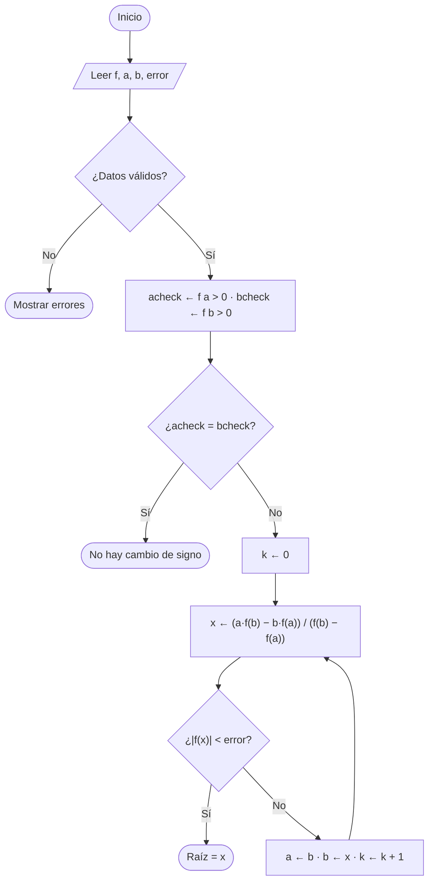
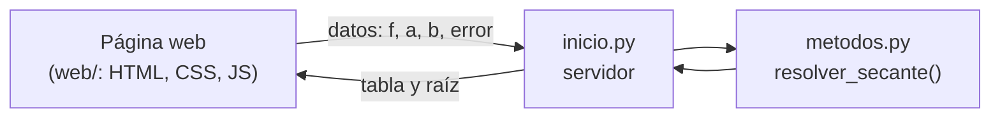

<div class="portada">
<p class="portada-institucion">Universidad Nacional del Este<br>Facultad Politécnica</p>
<p class="portada-carrera">Análisis de Sistemas</p>
<p class="portada-asignatura">Matemática IV — Cálculo Numérico</p>
<p class="portada-tipo">Informe técnico del Trabajo Práctico Grupal</p>
<p class="portada-titulo">Sistema de Cálculo Numérico:<br>Método de la Secante</p>
<p class="portada-grupo">Grupo 1 — Secante</p>
<p class="portada-etiqueta">Integrantes</p>
<p class="portada-integrantes">COMPLETAR: Nombre Apellido<br>COMPLETAR: Nombre Apellido<br>COMPLETAR: Nombre Apellido<br>COMPLETAR: Nombre Apellido</p>
<p class="portada-etiqueta">Docente</p>
<p class="portada-docente">Prof. Lic. Alicia Castillo de Dechia</p>
<p class="portada-fecha">4.º semestre — 2026<br>Ciudad del Este, Paraguay</p>
</div>

# Informe técnico — Sistema de Cálculo Numérico: Método de la Secante

> Sigue el orden que pide la guía del trabajo práctico (puntos 7, 8, 9, 11 y 16).

---

## Índice

1. [Tecnologías utilizadas](#1-tecnologías-utilizadas)
2. [Fundamento matemático](#2-fundamento-matemático)
3. [Diseño del sistema](#3-diseño-del-sistema)
4. [Implementación](#4-implementación)
5. [Validación de datos](#5-validación-de-datos)
6. [Casos de prueba y resultados](#6-casos-de-prueba-y-resultados)
7. [Funcionalidades adicionales](#7-funcionalidades-adicionales)
8. [Manual de uso](#8-manual-de-uso)

---

## 1. Tecnologías utilizadas

| Aspecto | Elección |
|---|---|
| Lenguaje del método | **Python 3.12**: dos archivos, `inicio.py` y `metodos.py` |
| Interfaz | **HTML + CSS + JavaScript**, sin frameworks |
| Servidor | `http.server` de la biblioteca estándar de Python |
| Ejecutable | **PyInstaller**: genera `MetodoSecante.exe` |
| Pruebas | `unittest` (biblioteca estándar) |
| IDE | Visual Studio Code |
| Control de versiones | Git + GitHub |

**Bibliotecas de Python usadas:** `math` (seno, coseno, logaritmo… para calcular f(x)), `json` y `http.server` (comunicación con la página), `webbrowser` (abrir el navegador).
**El método de la secante no usa ninguna biblioteca:** la fórmula, las iteraciones, el cambio de signo y el test de parada están programados en `metodos.py`. Python solo se usa como "calculadora" para obtener f(x), como permite la consigna ("como apoyo").

---

## 2. Fundamento matemático

### 2.1 Concepto

El método de la secante busca una raíz de f(x) = 0. Parte de dos valores, **a** y **b**, traza la recta (secante) que pasa por (a, f(a)) y (b, f(b)) y toma como nuevo valor el punto donde esa recta corta al eje x. Después repite el proceso con los dos últimos valores.


### 2.2 Notación

| Símbolo | Significado |
|---|---|
| k | número de iteración, empieza en 0 |
| a | x<sub>k−1</sub> (valor anterior) |
| b | x<sub>k</sub> (valor actual) |
| x<sub>k+1</sub> | valor nuevo |

### 2.3 Fórmula

La recta que pasa por (a, f(a)) y (b, f(b)) es y = f(b) + [(f(b) − f(a)) / (b − a)]·(x − b). Igualando y = 0 y despejando:

```
              a · f(b) − b · f(a)
   x(k+1) = ---------------------
                 f(b) − f(a)
```

Es equivalente a x<sub>k+1</sub> = b − f(b)·(b − a) / (f(b) − f(a)), la forma de Newton-Raphson con la derivada reemplazada por la pendiente de la secante. Por eso **no necesita la derivada**.

### 2.4 Condición previa: cambio de signo

Antes de iterar se verifica que f(a) y f(b) tengan signos opuestos:

```
acheck ← f(a) > 0
bcheck ← f(b) > 0
si acheck = bcheck → no hay cambio de signo: NO se resuelve
```

Si f es continua y hay cambio de signo, el **teorema de Bolzano** garantiza al menos una raíz entre a y b. En teoría la secante no exige esta condición (es un método abierto), pero el sistema la pide para asegurar que la raíz buscada esté entre los valores iniciales.


### 2.5 Algoritmo (pseudocódigo)

```
Leer f, a, b, error
acheck ← f(a) > 0
bcheck ← f(b) > 0
Si acheck = bcheck Entonces
    Escribir "No hay cambio de signo"
SiNo
    k ← 0
    encontrada ← Falso
    Mientras no encontrada y k < 100 Hacer
        x ← (a·f(b) − b·f(a)) / (f(b) − f(a))
        Si |f(x)| < error Entonces
            encontrada ← Verdadero
        FinSi
        a ← b
        b ← x
        k ← k + 1
    FinMientras
    Escribir "Raíz: ", x
FinSi
```

### 2.6 Diagrama de flujo



### 2.7 Criterio de parada y error

- **Test de parada:** se reemplaza x<sub>k+1</sub> en la función. Si **|f(x<sub>k+1</sub>)| < error**, x<sub>k+1</sub> es la raíz. Se usa el valor absoluto porque f puede ser negativa.
- **Sin máximo de iteraciones elegido por el usuario:** se itera hasta llegar al error pedido. Hay un límite interno de 100 iteraciones que solo actúa si el método no converge, para que el programa no quede trabado.
- **Otros cortes:** si f(a) = f(b) (la fórmula dividiría por cero) o si x<sub>k+1</sub> cae fuera del dominio de f.

### 2.8 Criterio de convergencia

Si f′(r) ≠ 0 y los valores iniciales están cerca de la raíz, el método converge con orden **φ = (1 + √5)/2 ≈ 1.618** (convergencia superlineal): en cada iteración la cantidad de cifras correctas se multiplica por ≈ 1.6. Es más rápido que bisección (orden 1) y algo más lento que Newton (orden 2).

### 2.9 Ventajas y limitaciones

**Ventajas**
- No necesita la derivada.
- Converge rápido (orden ≈ 1.618).
- Una sola evaluación nueva de f por iteración.

**Limitaciones**
- Si f(a) = f(b), divide por cero.
- Si a y b están lejos de la raíz, puede no converger.
- Una asíntota entre a y b produce un cambio de signo sin raíz (ej.: 1/x en [−1, 2]). El sistema avisa si la raíz encontrada queda fuera de [a, b].
- En raíces múltiples converge lento.

---

## 3. Diseño del sistema

### 3.1 Arquitectura



- **`inicio.py`:** se ejecuta al inicio. Prende un servidor web local, abre el navegador y, cuando se toca Resolver, llama a `metodos.resolver_secante()`.
- **`metodos.py`:** todos los métodos del cálculo, escritos paso a paso.
- **`web/`:** la página. Muestra la tabla y el test de parada, y hace en JavaScript el paso a paso, la animación, los gráficos, la comparación, el historial y la exportación.

### 3.2 Estructura de archivos

```
MATEMATICA/
├── inicio.py            Se ejecuta al inicio: servidor + llama a los métodos
├── metodos.py           Todos los métodos (validar, cambio de signo, fórmula, tabla)
├── construir_exe.py     Genera el ejecutable
├── tests/
│   └── test_metodos.py  Pruebas de metodos.py
├── web/                 La página
│   ├── index.html
│   ├── css/estilos.css
│   └── js/              app.js, pasos.js, animacion.js, comparacion.js, …
├── ejecutable/          MetodoSecante.exe
└── docs/                Documentación y capturas
```

### 3.3 Métodos de `metodos.py`

| Método | Qué hace |
|---|---|
| `preparar_funcion(texto)` | Convierte lo que escribe el usuario a Python: `x^3 - 4x` → `x**3-4*x` |
| `funcion_esta_bien_escrita(funcion)` | Revisa que la función sea válida y dependa de x |
| `evaluar(funcion, x)` | Calcula f(x) reemplazando x por el número |
| `leer_numero(texto)` | Convierte texto en número (acepta coma decimal) |
| `validar_datos(...)` | Arma la lista de errores de los datos ingresados |
| `hay_cambio_de_signo(fa, fb)` | acheck = f(a) > 0, bcheck = f(b) > 0; iguales → no hay cambio |
| `calcular_x_siguiente(a, b, fa, fb)` | La fórmula (a·f(b) − b·f(a)) / (f(b) − f(a)) |
| `resolver_secante(...)` | El método principal: valida, verifica el signo e itera armando la tabla |

### 3.4 Diseño de la interfaz

| Pestaña | Contenido |
|---|---|
| **Resolver** | Ecuación, a, b y error. Al resolver: el cambio de signo (a → f(a) → positivo o negativo, y lo mismo con b), la **tabla** (k, a, b, f(a), f(b), x<sub>k+1</sub>) y al lado el **test de parada** (f(x<sub>k+1</sub>) y la comparación con el error). |
| **Paso a paso** | La resolución de la tabla como la haría una persona: en cada iteración, la fórmula, el reemplazo y el resultado de f(a), f(b), x<sub>k+1</sub> y del test, con las celdas que se usan pintadas de colores. |
| **Animación** | El método sobre la gráfica: la secante, su corte con el eje x y el test de cada iteración. |
| **Comparar métodos** | Secante contra Newton-Raphson, falsa posición y bisección. |
| **Teoría** | Fórmula, algoritmo, ventajas y limitaciones. |
| **Historial** | Ejercicios resueltos (guardados en el navegador). |


---

## 4. Implementación

### 4.1 Cambio de signo

```python
def hay_cambio_de_signo(fa, fb):
    acheck = fa > 0          # ¿f(a) es positivo?
    bcheck = fb > 0          # ¿f(b) es positivo?

    if acheck == bcheck:     # los dos positivos o los dos negativos
        return False         # -> NO hay cambio de signo
    else:
        return True          # -> SÍ hay cambio de signo
```

### 4.2 La fórmula

```python
def calcular_x_siguiente(a, b, fa, fb):
    return (a * fb - b * fa) / (fb - fa)
```

### 4.3 Las iteraciones

```python
k = 0
encontrada = False
while not encontrada and k < LIMITE_DE_ITERACIONES:
    fa = evaluar(funcion, a)
    fb = evaluar(funcion, b)
    x = calcular_x_siguiente(a, b, fa, fb)

    fx = evaluar(funcion, x)          # test de parada: reemplazar x(k+1) en la función
    if abs(fx) < error:
        encontrada = True

    respuesta["tabla"].append({"k": k, "a": a, "b": b, "fa": fa, "fb": fb, "x": x, "fx": fx, ...})

    a = b                             # siguiente iteración
    b = x
    k = k + 1
```

### 4.4 Decisiones de implementación

| Decisión | Por qué |
|---|---|
| **Test de parada \|f(x<sub>k+1</sub>)\| < error** | Es el criterio visto en clase: se reemplaza x<sub>k+1</sub> en la función y se mira qué tan cerca de 0 queda. Mide directamente lo que se busca (f(x) = 0) y no necesita conocer la raíz. Se usa el valor absoluto porque f puede quedar negativa. En la sección 6.4 se analiza cuánto se aleja x de la raíz real con este criterio. |
| **Verificar el cambio de signo antes de iterar** | La secante no lo exige, pero así el teorema de Bolzano garantiza que hay una raíz entre a y b, y el resultado es la raíz que el usuario está buscando y no otra lejana. Si no hay cambio de signo, el sistema avisa y no arma la tabla. |
| **Si a o b ya son raíz, no se itera** | Si f(a) = 0 o f(b) = 0, la respuesta ya está y no hace falta armar la tabla. Se muestra directamente cuál de los dos es la raíz. |
| **Controlar f(a) = f(b)** | La fórmula divide por f(b) − f(a). Antes de calcular x<sub>k+1</sub> se revisa que no sea 0 y se muestra un mensaje, en vez de dejar que el programa falle. |
| **Límite interno de 100 iteraciones** | El usuario no elige un máximo de iteraciones: solo ingresa f, a, b y el error, como en clase. Pero si el método no converge, el ciclo no terminaría nunca. Como la secante converge con orden ≈ 1.618, un problema normal necesita menos de 10 iteraciones (sección 6.4). Llegar a 100 indica que no converge. |
| **Avisar si la raíz queda fuera de [a, b]** | Una asíntota (por ejemplo 1/x en [−1, 2]) produce un cambio de signo sin raíz. Si el resultado queda fuera del intervalo inicial, el sistema lo advierte. |
| **x<sub>k+1</sub> infinito o fuera del dominio** | Si la fórmula da infinito, o f no se puede calcular en x<sub>k+1</sub> (por ejemplo ln de un negativo), se corta con un mensaje claro en vez de mostrar un error de Python. |
| **f(x) se calcula con Python, el método no** | Python solo se usa como calculadora para obtener f(x): `eval` con una lista cerrada de nombres (x, sin, cos, ln, sqrt, e, pi…). Cualquier otro nombre se rechaza. La fórmula, las iteraciones y el test de parada están programados a mano en `metodos.py`, como pide la guía. |
| **Escritura natural de la función** | El usuario escribe como en el cuaderno: `x^3 - 4x - 1`, `2(x+1)`, coma decimal. `preparar_funcion` lo traduce a Python (`x**3-4*x-1`). |
| **Cálculo en Python, interfaz web** | El método queda en un archivo corto y fácil de leer (`metodos.py`). La página permite la tabla, el paso a paso, la animación y los gráficos sin instalar nada. Con PyInstaller todo queda en un solo `.exe`. |

---

## 5. Validación de datos

| Situación | Ejemplo | Mensaje |
|---|---|---|
| Datos incompletos | función vacía | "Falta escribir la función." |
| Función mal escrita | `x^3 - 4y` | "La función está mal escrita. Ejemplo válido: x^3 - 4x - 1" |
| Valores no numéricos | a = "dos" | "El valor inicial a debe ser un número." |
| Intervalo incorrecto | a = b | "a y b tienen que ser distintos." |
| Error inválido | 0 o −1 | "El error debe ser un número mayor que 0 (ej.: 0.0001)." |
| Fuera del dominio | ln(x) con a = −1 | "La función no se puede calcular en a o en b (fuera de su dominio)." |
| Sin cambio de signo | a = 1, b = 2 en x³ − 4x − 1 | "f(a) y f(b) son los dos negativos → no hay cambio de signo: no se resuelve la tabla." |
| División por cero | f(a) = f(b) | "f(a) y f(b) son iguales: no se puede dividir por cero." |
| No converge | — | "Después de 100 iteraciones no se llegó al error pedido: el método no converge." |
| Asíntota | 1/x en [−1, 2] | "Ojo: la raíz encontrada está fuera de [a, b]…" |

El programa nunca se cierra por un dato mal ingresado: muestra los errores en rojo junto a cada campo.


---

## 6. Casos de prueba y resultados

### 6.1 Ejemplo resuelto a mano: f(x) = x³ − 4x − 1, a = 2, b = 3, error = 0.0001

- **Cambio de signo:** f(2) = −1 (acheck = falso), f(3) = 14 (bcheck = verdadero) → hay cambio de signo.
- **k = 0:** x₁ = (2·14 − 3·(−1)) / (14 − (−1)) = 31/15 = **2.06666667** ✔ (coincide con el sistema)

| k | a | b | f(a) | f(b) | x<sub>k+1</sub> | f(x<sub>k+1</sub>) | ¿\|f\| < error? |
|---|---|---|---|---|---|---|---|
| 0 | 2 | 3 | −1 | 14 | 2.06666667 | −0.4397037 | no |
| 1 | 3 | 2.06666667 | 14 | −0.4397037 | 2.09508762 | −0.18418937 | no |
| 2 | 2.06666667 | 2.09508762 | −0.4397037 | −0.18418937 | 2.11557507 | 0.00628994 | no |
| 3 | 2.09508762 | 2.11557507 | −0.18418937 | 0.00628994 | 2.11489854 | −0.00008478 | **sí** |

**Raíz ≈ 2.11489854** (k = 3).

> El enunciado propone el intervalo [1, 2], pero ahí f(1) = −4 y f(2) = −1 tienen el mismo signo (acheck = bcheck = falso): **no hay cambio de signo** y el sistema no resuelve. La raíz (2.1149…) está fuera de [1, 2].

### 6.2 Otros casos

| f(x) | a, b | Error | Resultado |
|---|---|---|---|
| cos(x) − x | 0, 1 | 0.0001 | Raíz ≈ 0.7391 |
| e^(−x) − x | 0, 1 | 0.000001 | Raíz ≈ 0.5671 |
| x² − 2 | 1, 2 | 10⁻¹⁰ | Raíz ≈ 1.41421356 (√2) |
| x² − 4 | 2, 5 | 0.01 | a = 2 ya es raíz: f(2) = 0 |
| x³ − 4x − 1 | 1, 2 | 0.0001 | No hay cambio de signo: no se resuelve |
| 1/x | −1, 2 | 0.0001 | Advertencia: la "raíz" queda fuera de [a, b] (asíntota) |
| ln(x) | −1, 2 | 0.1 | Error: fuera del dominio |

### 6.3 Verificación con valores de referencia

Los resultados del sistema se compararon con el valor exacto de cada raíz, obtenido sin usar el método de la secante:

- **x³ − 4x − 1:** fórmula de Cardano (forma trigonométrica, porque tiene tres raíces reales): r = 2·√(4/3)·cos(⅓·arccos(3√3/16)) = 2.1149075414…
- **cos(x) − x:** número de Dottie, 0.7390851332…
- **e^(−x) − x:** constante omega, Ω = W(1) = 0.5671432904…
- **x² − 2:** √2 = 1.4142135624…

Los valores de referencia se pueden confirmar en GeoGebra (comando `Raíz(f, a, b)`) o en WolframAlpha.

| f(x) | a, b | Error | Iteraciones | Raíz del sistema | Valor de referencia | \|raíz − referencia\| | \|f(raíz)\| |
|---|---|---|---|---|---|---|---|
| x³ − 4x − 1 | 2, 3 | 10⁻⁴ | 4 | 2.11489854 | 2.11490754 | 9.0 × 10⁻⁶ | 8.5 × 10⁻⁵ |
| cos(x) − x | 0, 1 | 10⁻⁴ | 3 | 0.73911936 | 0.73908513 | 3.4 × 10⁻⁵ | 5.7 × 10⁻⁵ |
| e^(−x) − x | 0, 1 | 10⁻⁶ | 4 | 0.56714331 | 0.56714329 | 1.6 × 10⁻⁸ | 2.5 × 10⁻⁸ |
| x² − 2 | 1, 2 | 10⁻¹⁰ | 6 | 1.41421356 | 1.41421356 | < 10⁻¹⁵ | 4.4 × 10⁻¹⁶ |

En todos los casos se cumple el test de parada (|f(raíz)| < error) y la raíz coincide con el valor de referencia en las cifras que garantiza el error pedido.

### 6.4 Análisis del error y de la convergencia

**Velocidad de convergencia.** Se resolvió f(x) = x³ − 4x − 1 con a = 2 y b = 3, pero con un error muy chico (10⁻¹²) para ver más iteraciones. e<sub>k</sub> = |x<sub>k+1</sub> − r| es la distancia a la raíz exacta r = 2.11490754147676:

| k | x<sub>k+1</sub> | e<sub>k</sub> = \|x<sub>k+1</sub> − r\| | \|f(x<sub>k+1</sub>)\| | Orden estimado p |
|---|---|---|---|---|
| 0 | 2.066666666666667 | 4.8 × 10⁻² | 4.4 × 10⁻¹ | — |
| 1 | 2.095087618500431 | 2.0 × 10⁻² | 1.8 × 10⁻¹ | — |
| 2 | 2.115575069066892 | 6.7 × 10⁻⁴ | 6.3 × 10⁻³ | 3.81 |
| 3 | 2.114898540057763 | 9.0 × 10⁻⁶ | 8.5 × 10⁻⁵ | 1.27 |
| 4 | 2.114907537430406 | 4.0 × 10⁻⁹ | 3.8 × 10⁻⁸ | 1.79 |
| 5 | 2.114907541476780 | 2.5 × 10⁻¹⁴ | 2.3 × 10⁻¹³ | 1.56 |

El orden se estima con p ≈ ln(e<sub>k</sub> / e<sub>k−1</sub>) / ln(e<sub>k−1</sub> / e<sub>k−2</sub>). En las primeras iteraciones salta porque los valores todavía están lejos de la raíz. A medida que se acercan, p se estabiliza alrededor de **1.6**, que coincide con el orden teórico φ ≈ 1.618 (sección 2.8). Se ve en la tabla: el error pasa de 10⁻⁴ a 10⁻⁶, 10⁻⁹ y 10⁻¹⁴, y las cifras correctas se multiplican por ≈ 1.6 en cada paso. Por eso alcanzan 6 iteraciones para llegar a 10⁻¹².

**Qué garantiza el test de parada.** El sistema corta cuando |f(x)| < error, pero eso no es lo mismo que |x − r| < error. Cerca de la raíz, f(x) ≈ f′(r)·(x − r), entonces:

```
              |f(x)|
  |x − r| ≈ ----------
              |f′(r)|
```

- En x³ − 4x − 1, f′(r) = 3r² − 4 ≈ 9.42. Con |f| = 8.5 × 10⁻⁵, la distancia a la raíz es ≈ 8.5 × 10⁻⁵ / 9.42 ≈ 9.0 × 10⁻⁶, igual a la diferencia medida en la sección 6.3.
- En cos(x) − x, |f′(r)| = sin(r) + 1 ≈ 1.67, así que 5.7 × 10⁻⁵ / 1.67 ≈ 3.4 × 10⁻⁵, también igual a lo medido.

Cuando |f′(r)| > 1 (la función corta el eje con pendiente pronunciada), la raíz es incluso más precisa que el error pedido. Cuando la función es muy plana cerca de la raíz (|f′(r)| < 1, o raíces múltiples con f′(r) = 0), el valor de x puede quedar más lejos de la raíz de lo que sugiere el error. Esta es una limitación del criterio, y por eso conviene pedir un error más chico en esos casos.

### 6.5 Pruebas automáticas

`python -m unittest discover -s tests -t .` ejecuta las 10 pruebas de `tests/test_metodos.py`: conversión de la función, f(2) = −1, cambio de signo, la fórmula a mano (31/15), el ejemplo completo, el corrimiento de a y b, la falta de cambio de signo, las validaciones y la advertencia de asíntota.

### 6.6 Comparación con otros métodos (mismo problema)


Con el mismo test de parada |f(x)| < 0.0001: la secante necesitó 4 iteraciones, Newton-Raphson 4, falsa posición 11 y bisección 15.

---

## 7. Funcionalidades adicionales

| Sugerida en la guía | Implementación |
|---|---|
| Representación gráfica | Pestaña Animación: la función y las rectas secantes, con zoom y desplazamiento |
| Comparación automática | Secante, Newton-Raphson, falsa posición y bisección |
| Visualización del error | Cuadro del test de parada y paso a paso con colores |
| Exportación | Excel (CSV), texto e informe imprimible como PDF |
| Historial | Ejercicios resueltos, guardados en el navegador |
| Interfaz avanzada | Paso a paso animado, modo claro y oscuro, adaptable a celular |

---

## 8. Manual de uso

1. Abrir el programa: doble clic en `ejecutable/MetodoSecante.exe`, o `python inicio.py`.
2. Escribir la **ecuación** (por ejemplo `x^3 - 4x - 1`; se puede usar `sin`, `cos`, `ln`, `log`, `sqrt`, `e`, `pi`).
3. Escribir los valores iniciales **a** y **b**, de modo que f cambie de signo entre ellos.
4. Escribir el **error** (por ejemplo 0.0001).
5. Tocar **Resolver**. Aparecen el cambio de signo, la tabla y el test de parada.
6. Opcional: pestañas Paso a paso, Animación, Comparar métodos, Teoría e Historial.
7. Para cerrar: botón **Salir**.
