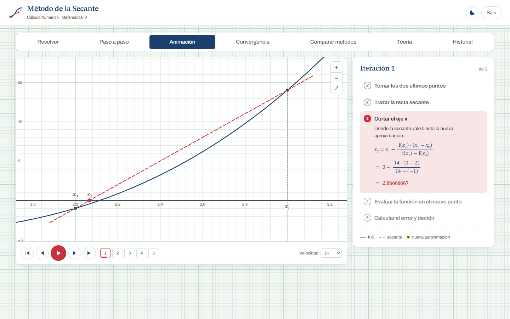
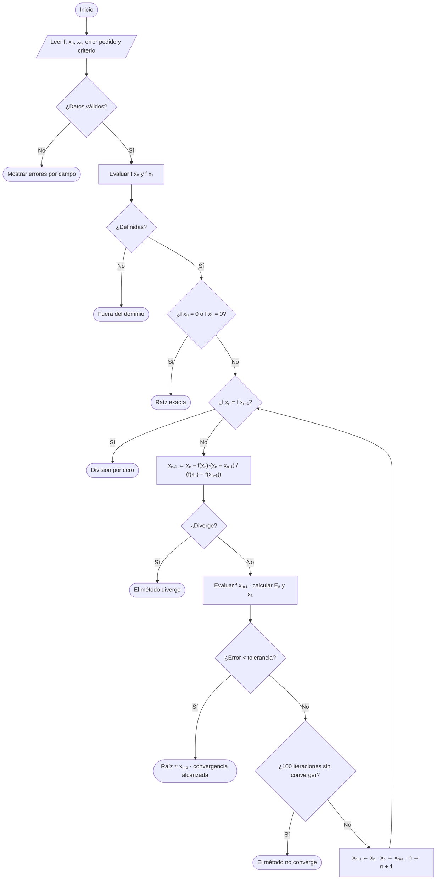
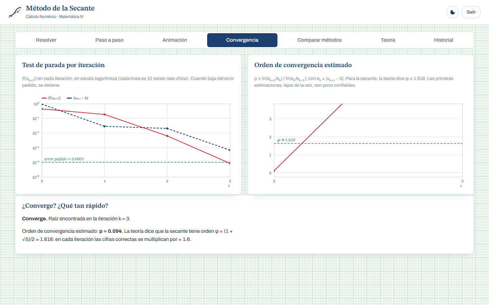
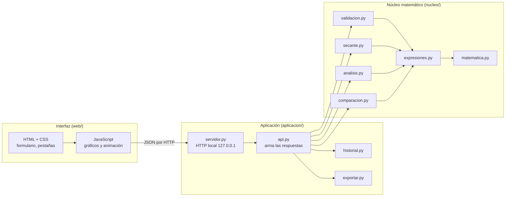
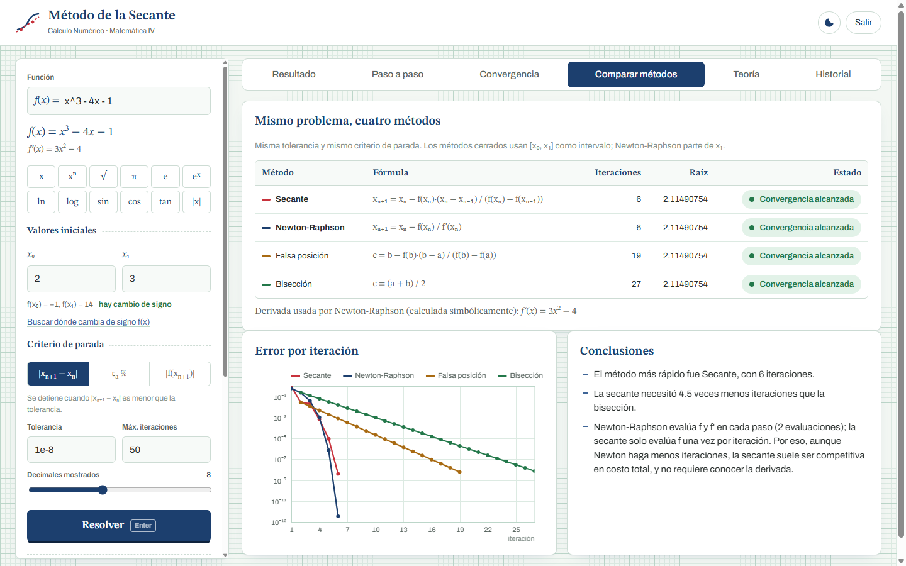

# Documentación técnica — Sistema de Cálculo Numérico: Método de la Secante

> Material base para el informe técnico del Trabajo Práctico de Matemática IV (Cálculo Numérico).
> Cada sección sigue el orden que pide la guía del trabajo práctico (puntos 7, 8, 9, 11 y 16).
> La portada (universidad, facultad, carrera, integrantes, docente, semestre) va en el informe final.

---

## Índice

1. [Tecnologías utilizadas](#1-tecnologías-utilizadas)
2. [Fundamento matemático](#2-fundamento-matemático)
3. [Diseño del sistema](#3-diseño-del-sistema)
4. [Implementación](#4-implementación)
5. [Validación de datos](#5-validación-de-datos)
6. [Casos de prueba y resultados](#6-casos-de-prueba-y-resultados)
7. [Funcionalidades adicionales (desafío de extensión)](#7-funcionalidades-adicionales-desafío-de-extensión)
8. [Manual de uso](#8-manual-de-uso)

---

## 1. Tecnologías utilizadas

| Aspecto | Elección | Por qué |
|---|---|---|
| Lenguaje de la lógica | **Python 3.12** | Sintaxis clara, ideal para traducir algoritmos matemáticos; permite generar un ejecutable. |
| Interfaz | **HTML5 + CSS3 + JavaScript** (sin frameworks) | Permite gráficos y animaciones ricas; se abre en cualquier navegador. |
| Servidor | `http.server` de la **biblioteca estándar** de Python | Conecta la interfaz con la lógica sin instalar nada. |
| Gráficos | **Canvas 2D** (interfaz) y **SVG** generado en Python (informe) | Dibujados a mano, sin bibliotecas de gráficos. |
| Ejecutable | **PyInstaller** | Empaqueta Python, el código y la interfaz en un solo `MetodoSecante.exe`. |
| Pruebas | `unittest` (biblioteca estándar) | 47 pruebas automáticas. |
| IDE | Visual Studio Code | — |
| Control de versiones | Git + GitHub | — |
| Tipografías | Archivo y STIX Two Text (licencia SIL OFL) | Incluidas en el proyecto: funciona **sin internet**. |

### Bibliotecas: qué se usa y qué NO

El proyecto **no usa ninguna biblioteca matemática**: ni `math`, ni `numpy`, ni `scipy`, ni `sympy`, ni `eval()`.
Todo el cálculo está implementado desde cero:

| Lo que normalmente se importaría | Lo que hicimos nosotros |
|---|---|
| `math.sin`, `math.cos`, `math.exp`, `math.log`, `math.sqrt`… | Series de Taylor con reducción de argumento y método de Newton (`nucleo/matematica.py`) |
| `eval("x**3 - 4*x - 1")` o `sympy.sympify` | Tokenizador + parser descendente recursivo + árbol de sintaxis (`nucleo/expresiones.py`) |
| `sympy.diff` (derivada para Newton-Raphson) | Derivación simbólica con las reglas de derivación sobre el árbol (`nucleo/expresiones.py`) |
| `scipy.optimize.newton` / `brentq` | Secante, bisección, falsa posición y Newton-Raphson escritos a mano (`nucleo/secante.py`, `nucleo/comparacion.py`) |
| `matplotlib` | Gráficos en canvas (interfaz) y SVG (informe) dibujados a mano |

Solo se usan módulos de la biblioteca estándar para tareas **no matemáticas**: `json` (historial), `http.server` y `socket` (servidor local), `webbrowser` (abrir el navegador), `html.escape` (informe) y `threading`.
El módulo `math` aparece **únicamente en las pruebas**, como referencia para verificar que nuestras funciones dan el mismo resultado.

---

## 2. Fundamento matemático

### 2.1 Concepto

El método de la secante resuelve ecuaciones no lineales de la forma **f(x) = 0**. Es un método **abierto e iterativo**.

Parte de **dos aproximaciones iniciales** x₀ y x₁. Por los puntos (x₀, f(x₀)) y (x₁, f(x₁)) traza una recta **secante** y toma como nueva aproximación el punto donde esa recta corta al eje x. Después repite el proceso con los dos últimos puntos, descartando el más viejo.

Geométricamente, reemplaza la curva por una recta en las cercanías de la raíz. Cuanto más cerca estamos de la raíz, más se parece la curva a esa recta y mejor es la aproximación.




### 2.2 Fórmula

La recta que pasa por (xₙ₋₁, f(xₙ₋₁)) y (xₙ, f(xₙ)) tiene pendiente

```
        f(xₙ) − f(xₙ₋₁)
  m  =  ───────────────
          xₙ − xₙ₋₁
```

y su ecuación es  y = f(xₙ) + m · (x − xₙ).

Para hallar el corte con el eje x se hace y = 0 y se despeja x:

```
                     f(xₙ) · (xₙ − xₙ₋₁)
  xₙ₊₁  =  xₙ  −  ─────────────────────────
                    f(xₙ) − f(xₙ₋₁)
```

**Relación con Newton-Raphson.** La fórmula de Newton es xₙ₊₁ = xₙ − f(xₙ)/f′(xₙ).
La secante reemplaza la derivada f′(xₙ) por el cociente incremental m, que es la pendiente de la secante. Por eso **no necesita conocer la derivada**.

### 2.3 Algoritmo

```
Entrada: f, x₀, x₁, error pedido (tolerancia), criterio de parada
Salida:  raíz aproximada, tabla de iteraciones, estado final

 1. Calcular f(x₀) y f(x₁). Si alguno no está definido → informar "fuera del dominio".
 2. Si f(x₀) = 0 o f(x₁) = 0 → ese valor es la raíz exacta.
 3. Para n = 1, 2, 3, … (hasta alcanzar el error pedido):
 4.     Si f(xₙ) − f(xₙ₋₁) = 0 → detener: la secante es horizontal (división por cero).
 5.     xₙ₊₁ ← xₙ − f(xₙ)·(xₙ − xₙ₋₁) / (f(xₙ) − f(xₙ₋₁))
 6.     Si xₙ₊₁ es infinito o crece sin control → detener: el método diverge.
 7.     Calcular f(xₙ₊₁). Si no está definido → detener: fuera del dominio.
 8.     Eₐ ← |xₙ₊₁ − xₙ|          εₐ ← |Eₐ / xₙ₊₁| · 100 %
 9.     Guardar la fila de la tabla.
10.     Si f(xₙ₊₁) = 0 → raíz exacta.
11.     Si el error elegido < tolerancia → convergencia alcanzada.
12.     xₙ₋₁ ← xₙ ,  xₙ ← xₙ₊₁       (se descarta el punto más viejo)
13. Protección: si tras 100 iteraciones el error sigue sin bajar → informar que no converge.
```

**Diagrama de flujo**



### 2.4 Condiciones de aplicación

- **f debe ser continua** cerca de la raíz y, para que converja con el orden esperado, **derivable con f′(r) ≠ 0** y f″ continua.
- Se necesitan **dos valores iniciales distintos** (x₀ ≠ x₁).
- **Regla del sistema: debe haber cambio de signo entre x₀ y x₁**, es decir f(x₀)·f(x₁) < 0. Si f es continua, el **teorema de Bolzano** garantiza entonces al menos una raíz entre ambos. El sistema lo evalúa antes de resolver y muestra f(x₀)·f(x₁) con su reemplazo y resultado. **Si no hay cambio de signo, no resuelve la tabla** y pide otros valores iniciales. También lo rechaza si el cambio de signo se debe a una asíntota (por ejemplo 1/x en [−1, 2]) o si f no está definida en x₀ o x₁.
- En teoría, la secante es un método **abierto** y **no necesita** que x₀ y x₁ encierren la raíz: el núcleo (`metodo_secante`) funciona igual sin cambio de signo. Exigirlo es una decisión del sistema para garantizar que la raíz buscada esté entre los valores iniciales.
- Conviene que x₀ y x₁ estén **cerca de la raíz**.


### 2.5 Criterio de convergencia (orden φ ≈ 1.618)

Sea eₙ = xₙ − r el error en el paso n. Desarrollando f por Taylor alrededor de la raíz r se obtiene

```
  eₙ₊₁ ≈ C · eₙ · eₙ₋₁        con   C = f″(r) / (2·f′(r))
```

Si buscamos un orden p tal que |eₙ₊₁| ≈ A·|eₙ|ᵖ, al reemplazar resulta

```
  p² = p + 1    ⟹    p = (1 + √5) / 2 = φ ≈ 1.618      (el número áureo)
```

- La convergencia es **superlineal**: más rápida que bisección (lineal, p = 1) y algo más lenta que Newton (cuadrática, p = 2).
- En la práctica, **la cantidad de cifras correctas se multiplica por ≈ 1.6 en cada iteración**.
- Si la raíz es **múltiple** (f′(r) = 0), la convergencia pasa a ser solo lineal. El sistema lo detecta: con f(x) = (x − 1)² estima p = 1.000.
- El sistema **estima p experimentalmente** a partir de tres errores consecutivos:

```
        ln(eₙ₊₁ / eₙ)
  p ≈  ───────────────
        ln(eₙ / eₙ₋₁)
```



### 2.6 Criterio de parada

El usuario elige uno de tres criterios:

| Criterio | Condición para detenerse | Uso típico |
|---|---|---|
| Error absoluto | \|xₙ₊₁ − xₙ\| < tolerancia | Cuando importa la precisión en x (por ejemplo, 4 decimales). |
| Error relativo porcentual | \|(xₙ₊₁ − xₙ)/xₙ₊₁\| · 100 < tolerancia (en %) | Cuando la raíz es muy grande o muy chica. |
| Residuo | \|f(xₙ₊₁)\| < tolerancia | Cuando importa que f quede cerca de 0. |

Además, el método **siempre** se detiene:

- al encontrar f(xₙ₊₁) = 0 exactamente (raíz exacta);
- **no hay un máximo de iteraciones elegido por el usuario**: se itera hasta alcanzar el error pedido. Solo existe un límite interno de seguridad de 100 iteraciones, que actúa únicamente cuando el método **no converge** (sin él, el programa quedaría en un ciclo infinito). Cuando converge, la secante lo hace en pocas iteraciones;
- ante **división por cero**, **divergencia** o **salida del dominio**, informando el motivo;
- si las aproximaciones dejan de cambiar porque se llegó al límite de precisión de la máquina.

### 2.7 Error aproximado

Como no conocemos la raíz exacta, el error se **aproxima** con la diferencia entre dos aproximaciones consecutivas:

```
  Error absoluto aproximado:   Eₐ = |xₙ₊₁ − xₙ|
  Error relativo aproximado:   εₐ = |(xₙ₊₁ − xₙ) / xₙ₊₁| · 100 %
```

Con el **criterio de Scarborough** el sistema informa cuántas cifras significativas son confiables.
Si εₐ < 0.5 · 10^(2−n) %, el resultado tiene al menos n cifras correctas. Despejando, n = 2 − log₁₀(2·εₐ).

**Otras fuentes de error** que el sistema contempla:

- **Error de redondeo.** La computadora trabaja con unas 16 cifras significativas (doble precisión IEEE 754). Por eso no se aceptan tolerancias menores a 10⁻¹⁵.
- **Error de cancelación.** Cerca de la raíz, f(xₙ) − f(xₙ₋₁) es una resta de números muy parecidos. Por esa razón las estimaciones del orden que ya están dominadas por el redondeo se descartan.

### 2.8 Ventajas

1. **No necesita la derivada**, que puede ser difícil o imposible de obtener (por ejemplo, si f sale de una simulación).
2. Converge rápido, con orden ≈ 1.618: en el ejemplo del enunciado necesita 6 iteraciones contra 27 de bisección.
3. Hace **una sola evaluación nueva de f por iteración**, mientras que Newton necesita f y f′. En costo por evaluación, muchas veces es más eficiente que Newton.
4. No exige un intervalo con cambio de signo.

### 2.9 Limitaciones

1. **No garantiza convergencia**: puede diverger si los valores iniciales están lejos de la raíz. Ejemplo: f(x) = 1/x.
2. **División por cero** si f(xₙ) = f(xₙ₋₁): la secante es horizontal. Ejemplo: f(x) = x² − 4 con x₀ = −1, x₁ = 1.
3. Como **no encierra la raíz**, puede saltar a otra raíz distinta de la buscada o salir del dominio de f. Ejemplo: ln(x) con x₀ = −1.
4. En **raíces múltiples** la convergencia se vuelve lineal y lenta.
5. Sufre **error de cancelación** cerca de la raíz.

### 2.10 Métodos complementarios (para la comparación)

| Método | Tipo | Fórmula | Orden | Requiere |
|---|---|---|---|---|
| **Secante** | Abierto | xₙ₊₁ = xₙ − f(xₙ)(xₙ − xₙ₋₁)/(f(xₙ) − f(xₙ₋₁)) | φ ≈ 1.618 | 2 valores iniciales |
| Newton-Raphson | Abierto | xₙ₊₁ = xₙ − f(xₙ)/f′(xₙ) | 2 | f′(x) (calculada simbólicamente por el sistema) |
| Falsa posición | Cerrado | c = b − f(b)(b − a)/(f(b) − f(a)) | 1 (lineal) | Cambio de signo en [a, b] |
| Bisección | Cerrado | c = (a + b)/2 | 1 (lineal) | Cambio de signo en [a, b] |

La **falsa posición** usa la misma fórmula que la secante. La diferencia es que conserva el extremo que mantiene el cambio de signo, en lugar de descartar siempre el punto más viejo. Por eso siempre converge, aunque más lento.

---

## 3. Diseño del sistema

### 3.1 Arquitectura general

El sistema tiene tres capas. La **lógica matemática** es independiente de la interfaz: se puede probar y usar sin el navegador.



**Flujo de un cálculo:** el usuario completa el formulario → JavaScript envía los datos en JSON a `/api/resolver` → `validacion.py` controla cada campo → `expresiones.py` convierte el texto de la función en un árbol evaluable → `secante.py` itera → `analisis.py` y `comparacion.py` estudian el resultado → la respuesta vuelve en JSON → la interfaz la muestra y la anima.

### 3.2 Estructura de módulos

```
MATEMATICA/
├── app.py                    Punto de entrada: levanta el servidor y abre el navegador
├── construir_exe.py          Genera dist/MetodoSecante.exe con PyInstaller
├── nucleo/                   ── LÓGICA MATEMÁTICA (sin bibliotecas) ──
│   ├── matematica.py         exp, ln, sen, cos, atan, √, potencias… (series de Taylor, Newton)
│   ├── expresiones.py        Intérprete de funciones: tokenizador, parser, evaluación, derivada
│   ├── secante.py            ★ Método de la secante
│   ├── validacion.py         Validación de los datos de entrada
│   ├── analisis.py           Bolzano, búsqueda de intervalos, orden de convergencia, conclusiones
│   └── comparacion.py        Bisección, falsa posición y Newton-Raphson para comparar
├── aplicacion/               ── CONEXIÓN CON LA INTERFAZ ──
│   ├── api.py                Funciones que atiende el servidor
│   ├── servidor.py           Servidor HTTP local (biblioteca estándar)
│   ├── historial.py          Historial de ejercicios en JSON
│   └── exportar.py           Exportación a CSV, TXT e informe HTML con gráfico SVG
├── web/                      ── INTERFAZ ──
│   ├── index.html, css/estilos.css
│   ├── js/                   app.js (pantalla), pasos.js (paso a paso), animacion.js + lienzo.js (animación), lineas.js, …
│   └── fuentes/              Tipografías incluidas (funciona sin internet)
├── tests/                    47 pruebas automáticas
└── docs/                     Esta documentación, la guía del código y las capturas
```

### 3.3 Pseudocódigo del intérprete de funciones

El texto `"x^3 - 4x - 1"` se procesa en tres etapas.

```
1) TOKENIZAR:   "x^3 - 4x - 1"  →  [x] [^] [3] [−] [4] [x] [−] [1]

2) PARSEAR (gramática, de menor a mayor precedencia):
     expresion → termino (('+' | '−') termino)*
     termino   → unario (('*' | '/') unario | multiplicación implícita)*
     unario    → '−' unario | potencia
     potencia  → primario ('^' unario)?
     primario  → número | x | constante | función '(' expresion ')' | '(' expresion ')'

   Resultado: árbol de sintaxis
                 (−)
                /   \
             (−)     1
            /   \
         (^)    (·)
        /  \    /  \
       x    3  4    x

3) EVALUAR: se recorre el árbol; cada nodo calcula su valor con matematica.py
```

### 3.4 Diseño de la interfaz

La interfaz usa la estética de una **hoja de papel milimetrado de dibujo técnico**: tinta azul para la función y lápiz rojo para las rectas secantes. Tiene modo claro y modo oscuro (estilo cianotipo).

| Zona | Contenido |
|---|---|
| **Resolver** (página de inicio) | Arriba, los datos: la ecuación f(x) con vista previa y teclado matemático, los valores iniciales x₀ y x₁ y el error pedido. Al resolver, primero se muestra si **hay cambio de signo** entre x₀ y x₁: f(x₀)·f(x₁) con su reemplazo y resultado (teorema de Bolzano). Abajo, dos cuadros lado a lado: a la izquierda **la tabla** (n, xₙ₋₁, xₙ, f(xₙ₋₁), f(xₙ), xₙ₊₁) que arranca con los valores iniciales; a la derecha **la comparativa del error**, fila por fila, con el **criterio de parada elegible desde la cabecera del cuadro**. Debajo, la raíz obtenida y la exportación. |
| **Paso a paso** | La resolución de la tabla, celda por celda. Arranca con los dos valores iniciales y en cada iteración muestra, para f(xₙ₋₁), f(xₙ), xₙ₊₁ y el error: la **fórmula**, el **reemplazo** con los números y el **resultado**, que se carga en su celda. Al final compara el error con el pedido y decide si sigue o se detiene. **Las celdas que se usan en cada cálculo se pintan de colores** (xₙ₋₁ azul, xₙ violeta, f(xₙ₋₁) naranja, f(xₙ) verde, xₙ₊₁ rojo, error magenta) y los números del reemplazo llevan el mismo color, así se ve de dónde sale cada valor. |
| **Animación** | El método sobre la gráfica de f(x): en cada iteración se marcan los dos puntos, se dibuja la recta secante, se marca su corte con el eje x (xₙ₊₁), se evalúa f(xₙ₊₁) y se muestra el error como una cota. La cámara sigue a cada iteración. |
| **Convergencia** | Error por iteración (escala logarítmica) y orden de convergencia estimado comparado con φ. |
| **Comparar métodos** | Secante, Newton-Raphson, falsa posición y bisección sobre el mismo problema. |
| **Teoría** | Fundamento, fórmula, algoritmo, condiciones, ventajas y limitaciones. |
| **Historial** | Ejercicios resueltos, con la opción de volver a resolverlos. |


---

## 4. Implementación

### 4.1 El método de la secante (`nucleo/secante.py`)

Fragmento central del bucle de iteraciones:

```python
for n in range(1, limite_iteraciones + 1):     # sin máximo del usuario: límite de seguridad

    denominador = f_actual - f_anterior
    if denominador == 0:
        # La secante es horizontal: nunca corta al eje x
        resultado.estado = DIVISION_CERO
        ...
        return resultado

    # Fórmula de la secante
    x_siguiente = x_actual - f_actual * (x_actual - x_anterior) / denominador

    if not m.es_finito(x_siguiente) or m.valor_absoluto(x_siguiente) > limite:
        resultado.estado = DIVERGENCIA
        ...

    f_siguiente, error = _evaluar(f, x_siguiente, "x%d" % (n + 1))
    error_absoluto, error_relativo = calcular_errores(x_siguiente, x_actual)
    resultado.iteraciones.append(Iteracion(n, x_anterior, x_actual, f_anterior, f_actual,
                                           x_siguiente, f_siguiente, error_absoluto, error_relativo))

    if cumple_criterio(criterio, tolerancia, error_absoluto, error_relativo, f_siguiente):
        resultado.estado = CONVERGIO
        return resultado

    # Se descarta el punto más viejo y se avanza
    x_anterior, f_anterior = x_actual, f_actual
    x_actual, f_actual = x_siguiente, f_siguiente
```

### 4.2 Funciones matemáticas propias (`nucleo/matematica.py`)

Ejemplo: **eˣ** por reducción de argumento y serie de Taylor.

```python
def exp(x):
    # x = k·ln2 + r  con |r| ≤ 0.347   ⟹   eˣ = 2ᵏ · eʳ
    k = redondear_entero(x / LN2)
    r = (x - k * LN2_ALTO) - k * LN2_BAJO

    suma = 1.0
    termino = 1.0
    for n in range(1, MAX_TERMINOS):
        termino *= r / n               # rⁿ/n! a partir del término anterior
        nueva = suma + termino
        if nueva == suma:              # el término ya no cambia el resultado
            break
        suma = nueva
    return escalar_por_potencia_de_dos(suma, k)
```

| Función | Técnica |
|---|---|
| eˣ | Reducción x = k·ln2 + r y serie de Taylor de eʳ |
| ln x | x = m·2ᵏ y serie de la arcotangente hiperbólica: ln m = 2·atanh((m−1)/(m+1)) |
| sen x, cos x | Reducción al intervalo [−π/4, π/4] (cuadrantes) y series de Taylor |
| atan x | Identidades atan(x) = π/2 − atan(1/x) y desplazamiento de π/6, luego serie |
| asin, acos | A partir de atan y √ |
| √x | Método de Newton: yₙ₊₁ = (yₙ + x/yₙ)/2 |
| ∛x | Aproximación con exp/ln y pulido con Newton |
| aᵇ | Exponenciación binaria si b es entero; e^(b·ln a) si no |

Todas coinciden con el módulo `math` de Python con un error relativo menor a 10⁻¹² (lo verifican las pruebas).

### 4.3 Derivación simbólica (`nucleo/expresiones.py`)

Para comparar con Newton-Raphson hace falta f′(x). En lugar de usar una biblioteca, el sistema **deriva el árbol** aplicando las reglas de derivación y después simplifica el resultado:

```python
if op == "*":
    if not contiene_x(u):
        return Binario("*", u, dv)                                # (c·v)' = c·v'
    return Binario("+", Binario("*", du, v), Binario("*", u, dv))  # regla del producto
```

Ejemplo: para f(x) = x³ − 4x − 1 el sistema obtiene f′(x) = 3x² − 4.

---

## 5. Validación de datos

Correspondencia con el punto 9 de la guía del trabajo práctico. El sistema **nunca se cierra inesperadamente**: cada problema se informa con un mensaje claro junto al campo correspondiente.

| Situación (guía) | Ejemplo | Mensaje del sistema |
|---|---|---|
| Datos incompletos | x₀ vacío | "Falta ingresar el valor inicial x₀." |
| Valores no numéricos | x₀ = "abc" | "El valor inicial x₀ debe ser un número (se ingresó "abc")." |
| Función mal escrita | `x^3 - 4x + sen(x` | "Falta cerrar un paréntesis ')'" (con el lugar subrayado en rojo) |
| Variable desconocida | `x + y` | "No se reconoce 'y'. La función debe depender solo de x…" |
| Sin cambio de signo | x₀ = 1, x₁ = 2 en x³ − 4x − 1 | "f(x₀)·f(x₁) = (−4)·(−1) = 4 > 0. No hay cambio de signo: no se resuelve la tabla." |
| Intervalo incorrecto | x₀ = x₁ | "x₀ y x₁ deben ser distintos: la secante necesita dos puntos diferentes…" |
| División por cero | f(xₙ) = f(xₙ₋₁) | "La recta secante es horizontal y no corta al eje x. Probá con otros valores iniciales." |
| División por cero en f | 1/x en x = 0 | "f(x) no se puede evaluar en … División por cero" |
| Fuera del dominio | ln(x) con x₀ = −1 | "√x solo está definida para x ≥ 0…", "ln(x) solo está definido para x > 0…" |
| Error pedido inválido | 0, −1 o 10⁻²⁰ | "El error pedido debe ser un número positivo…" / "…demasiado chico…" |
| Condiciones que impiden la convergencia | 1/x, x² + 1 | "El método diverge…" / "Después de 100 iteraciones el error todavía no es menor al pedido: el método no converge…" |
| Función constante | f(x) = 5 | "La función es constante (no depende de x)…" |
| Coma decimal | 0,001 | Se acepta y se convierte a 0.001 |
| Valores como expresión | x₀ = pi/4 | Se acepta: los campos numéricos admiten expresiones constantes |

Además, el sistema **junta todos los errores a la vez** (no solo el primero) y los marca en rojo en cada campo.


---

## 6. Casos de prueba y resultados

### 6.1 Ejemplo del enunciado, verificado a mano

**f(x) = x³ − 4x − 1, error pedido 0.0001 (error absoluto)**

El enunciado propone el intervalo [1, 2], pero ahí **no hay cambio de signo**: f(1) = −4 y f(2) = −1, f(1)·f(2) = 4 > 0. La raíz (2.1149…) está fuera de ese intervalo, así que el sistema no resuelve la tabla con [1, 2]. Se usa **x₀ = 2, x₁ = 3**:

- Cambio de signo: f(2) = 8 − 8 − 1 = −1, f(3) = 27 − 12 − 1 = 14, f(2)·f(3) = −14 < 0 ✔
- Iteración 1, a mano: x₂ = 3 − 14·(3 − 2) / (14 − (−1)) = 3 − 14/15 = **2.06666667** ✔ (coincide con el sistema)

| n | xₙ₋₁ | xₙ | xₙ₊₁ | f(xₙ₊₁) | Eₐ | εₐ % |
|---|---|---|---|---|---|---|
| 1 | 2 | 3 | 2.06666667 | −0.4397037 | 0.93333333 | 45.16129032 |
| 2 | 3 | 2.06666667 | 2.09508762 | −0.18418937 | 0.02842095 | 1.35655194 |
| 3 | 2.06666667 | 2.09508762 | 2.11557507 | 0.00628994 | 0.02048745 | 0.96841047 |
| 4 | 2.09508762 | 2.11557507 | 2.11489854 | −0.00008478 | 0.00067653 | 0.03198872 |
| 5 | 2.11557507 | 2.11489854 | 2.11490754 | −3.8111·10⁻⁸ | 0.000009 | 0.00042543 |

**Resultado:** raíz aproximada **2.11490754**, 5 iteraciones, error aproximado 9·10⁻⁶ < 0.0001, estado: convergencia alcanzada.
Con una tolerancia más chica la raíz da 2.11490754148, que coincide con la raíz real de x³ − 4x − 1 = 0.

### 6.2 Batería de casos

Comportamiento del **método** (núcleo `metodo_secante`) en distintos casos. Las columnas de la derecha son la comparación automática.
Los casos marcados con ✗ **no tienen un cambio de signo válido** entre x₀ y x₁: **el sistema no los resuelve** y lo informa. Se incluyen porque las pruebas automáticas verifican cómo se comporta el método por sí solo.

| f(x) | x₀, x₁ | Tol. | Estado | Iter. | Raíz | p estimado | Newton | Falsa pos. | Bisección |
|---|---|---|---|---|---|---|---|---|---|
| ✗ x³ − 4x − 1 | 1, 2 | 10⁻⁴ | Convergió | 5 | 2.114907508 | 1.545 | 3 | no aplica | no aplica |
| x³ − 4x − 1 | 2, 3 | 10⁻⁸ | Convergió | 6 | 2.114907541 | 1.525 | 6 | 19 | 27 |
| x³ − 4x − 1 | −1, 0 | 10⁻⁴ | Convergió | 4 | −0.254101722 | 1.716 | 3 | 4 | 14 |
| cos x − x | 0, 1 | 10⁻⁸ | Raíz exacta* | 6 | 0.739085133 | 1.599 | 4 | 8 | 27 |
| e⁻ˣ − x | 0, 1 | 10⁻⁸ | Convergió | 6 | 0.567143290 | 1.667 | 4 | 9 | 27 |
| x² − 2 | 1, 2 | 10⁻¹⁰ | Convergió | 7 | 1.414213562 (= √2) | 1.579 | 5 | 14 | 34 |
| x·sen x − 1 | 0, 2 | 10⁻⁸ | Convergió | 5 | 1.114157141 | 0.688† | 6 | 5 | 28 |
| ln x + x − 2 | 1, 3 | 10⁻⁸ | Raíz exacta* | 6 | 1.557145599 | 1.569 | 5 | 9 | 28 |
| ✗ (x − 1)² | 0, 0.5 | 10⁻⁴ | Convergió (lento) | 17 | 0.999852 | **1.000** | 13 | no aplica | no aplica |
| ✗ x² + 1 | 0, 1 | 10⁻⁴ | División por cero | — | sin raíz real | — | — | — | — |
| ✗ x² − 4 | −1, 1 | 10⁻⁴ | División por cero | — | — | — | — | — | — |
| ✗ 1/x | −1, 2 | 10⁻⁴ | Diverge | — | sin raíz | — | — | — | discontinuidad** |
| ✗ ln x | −1, 2 | 10⁻⁴ | Fuera del dominio | — | — | — | — | — | — |

\* "Raíz exacta" significa que f(xₙ₊₁) dio exactamente 0 en la aritmética de la computadora.
† Con pocas iteraciones, y partiendo lejos de la raíz, la estimación de p no es confiable: la fórmula supone que ya estamos cerca de r.
\*\* La bisección se estabiliza en x = 0, pero ahí f(x) no se anula: es una asíntota. El sistema lo detecta y no lo cuenta como raíz.

**Análisis:**
- En los casos de raíz simple con suficientes iteraciones, el orden estimado está entre 1.52 y 1.72, muy cerca del teórico φ ≈ 1.618.
- En la raíz doble (x − 1)² el orden baja a 1.000: se confirma la limitación teórica.
- La secante necesitó entre 3 y 5 veces menos iteraciones que la bisección.
- En [1, 2] no hay cambio de signo: bisección y falsa posición no se pueden aplicar, y el sistema tampoco resuelve la secante. Con [2, 3] (cambio de signo) los cuatro métodos llegan a la misma raíz.

### 6.3 Verificación con herramientas de referencia

La carpeta `tests/` contiene **47 pruebas automáticas** (`python -m unittest discover -s tests -t .`) que verifican:

- Las funciones matemáticas propias contra el módulo `math`, en miles de puntos (error relativo < 10⁻¹²).
- El parser: precedencia, multiplicación implícita y errores de sintaxis con su posición.
- La derivada simbólica contra el cociente incremental numérico.
- La primera iteración del ejemplo, calculada a mano.
- Raíces conocidas (√2, el número omega 0.5671…, el número de Dottie 0.7390…).
- Todos los estados de error: división por cero, divergencia, dominio y falta de convergencia.
- La validación de cada tipo de dato inválido.
- El orden de convergencia ≈ φ y la detección de asíntotas.

---

## 7. Funcionalidades adicionales (desafío de extensión)

Correspondencia con el punto 16 de la guía del trabajo práctico:

| Funcionalidad sugerida | Implementación |
|---|---|
| Representación gráfica de funciones | Gráfico interactivo en la pestaña Animación (zoom, desplazamiento, asíntotas) y gráfico SVG dibujado en Python en el informe exportado. |
| Gráficas de convergencia | Error por iteración (escala logarítmica) y orden de convergencia estimado. |
| Comparación automática entre métodos | Secante contra Newton-Raphson, falsa posición y bisección, con tabla, gráfico y conclusiones. |
| Cálculo y visualización del error | Error absoluto, relativo y cifras significativas (Scarborough). En el paso a paso, cada error se muestra con su fórmula, su reemplazo y su comparación con el error pedido. |
| Exportación de resultados | CSV (se abre en Excel), TXT e informe HTML imprimible como PDF, con gráfico. |
| Historial de ejercicios resueltos | Se guarda automáticamente y permite volver a resolver o borrar. |
| Interfaz gráfica avanzada | Paso a paso de la tabla con celdas pintadas por colores, animación del método sobre la gráfica, modo claro y oscuro, adaptable a celular, teclado matemático. |
| Generación de informes | Informe completo: problema, resultado, Bolzano, gráfico, tabla, análisis y comparación. |
| Incorporación de métodos adicionales | Bisección, falsa posición y Newton-Raphson (con derivada simbólica propia). |
| Análisis automático de la convergencia | Orden estimado contra φ, monotonía del error, raíces múltiples, asíntotas, saltos a otras raíces y conclusiones en texto. |

Extras no pedidos:

- Verificación del teorema de Bolzano y detección de asíntotas (en el análisis y en el informe exportado).
- Funciones matemáticas propias, sin la biblioteca `math`.
- Funciona sin internet y sin instalar nada (ejecutable).



---

## 8. Manual de uso

### Ejecutar

- **Ejecutable:** doble clic en `MetodoSecante.exe`. Se abre una ventana negra (el servidor) y el navegador con el programa. Para salir, usá el botón **Salir** o cerrá la ventana negra.
- **Desde el código:** `python app.py` (requiere Python 3.10 o superior, sin dependencias).
- **Generar el ejecutable:** `python -m pip install pyinstaller` y luego `python construir_exe.py`.

### Resolver un problema

1. Escribir la función en **f(x) =**. Se aceptan `x^3 - 4x - 1`, `cos(x) - x`, `e^(-x) - x`, `2sin(x)`, `sqrt(x)`, `ln(x)`, `log(x)`, `pi`, `e`, etc. La multiplicación puede omitirse (`4x`).
2. Ingresar los valores iniciales **x₀** y **x₁**, de modo que **f cambie de signo entre ellos** (si no, el sistema avisa y no resuelve).
3. Ingresar el **error** pedido (por ejemplo 0.0001).
4. Presionar **Resolver** (o Enter). Aparecen la **tabla** y, a la derecha, la **comparativa del error**.
5. Para cambiar el **criterio de parada**, elegirlo en la cabecera del cuadro del error: el problema se vuelve a resolver solo.
6. Opcional: recorrer las pestañas **Paso a paso**, **Animación** (espacio = reproducir o pausar, flechas = avanzar o retroceder), **Convergencia**, **Comparar métodos**, **Teoría** e **Historial**.
7. Exportar con los botones **Informe**, **Excel (CSV)** o **Texto**.
