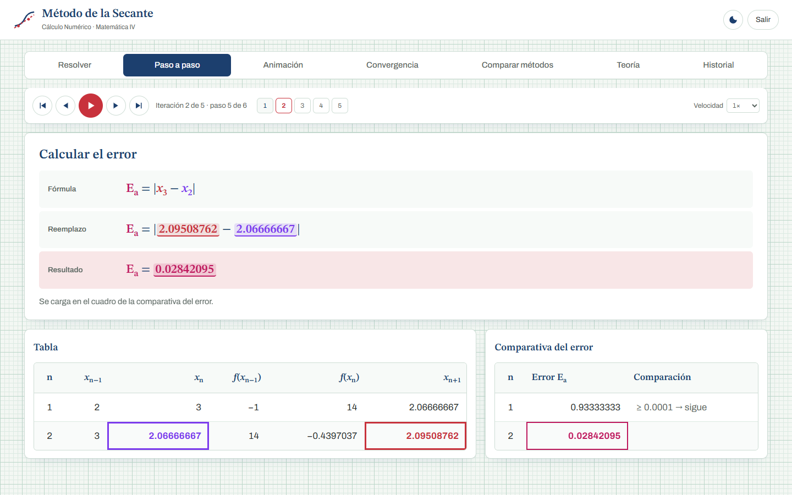

# Guía del código — cómo funciona la lógica del sistema

> **Para:** los integrantes del grupo.
> **Objetivo:** que cada uno pueda explicar y defender **cualquier parte de la lógica** frente a los profesores.
> **Alcance:** solo la parte matemática y lógica (`nucleo/`, y un repaso de `aplicacion/`). La parte web (`web/`) no se explica acá: es la "pantalla" que muestra lo que calcula Python.

La guía de la cátedra dice: *"En caso de utilizar herramientas de Inteligencia Artificial como apoyo, el grupo deberá ser capaz de explicar y defender cada parte del código utilizado"*. Esta guía es para eso. Leela con el código abierto al lado.

---

## Índice

1. [Mapa del proyecto: qué es lógica y qué no](#1-mapa-del-proyecto-qué-es-lógica-y-qué-no)
2. [El método de la secante en 5 minutos (con el ejemplo a mano)](#2-el-método-de-la-secante-en-5-minutos)
3. [El recorrido de un cálculo, de punta a punta](#3-el-recorrido-de-un-cálculo-de-punta-a-punta)
4. [`matematica.py` — las funciones matemáticas hechas a mano](#4-matematicapy--las-funciones-matemáticas-hechas-a-mano)
5. [`expresiones.py` — cómo el programa "entiende" la función](#5-expresionespy--cómo-el-programa-entiende-la-función)
6. [`secante.py` — el método, línea por línea](#6-secantepy--el-método-línea-por-línea)
7. [`validacion.py` — que nada rompa el programa](#7-validacionpy--que-nada-rompa-el-programa)
8. [`analisis.py` — Bolzano, asíntotas y orden de convergencia](#8-analisispy--bolzano-asíntotas-y-orden-de-convergencia)
9. [`comparacion.py` — los otros tres métodos](#9-comparacionpy--los-otros-tres-métodos)
10. [`aplicacion/` — el pegamento (repaso rápido)](#10-aplicacion--el-pegamento-repaso-rápido)
11. [Las pruebas automáticas](#11-las-pruebas-automáticas)
12. [Preguntas probables en la defensa (con respuesta)](#12-preguntas-probables-en-la-defensa-con-respuesta)
13. [Glosario](#13-glosario)

---

## 1. Mapa del proyecto: qué es lógica y qué no

```
nucleo/            ← LÓGICA MATEMÁTICA. Es lo que hay que dominar.
  matematica.py      funciones exp, ln, sin, cos, √… hechas con series y Newton
  expresiones.py     convierte el texto "x^3 - 4x - 1" en algo que se puede evaluar
  secante.py         ★ EL MÉTODO DE LA SECANTE
  validacion.py      controla los datos que ingresa el usuario
  analisis.py        Bolzano, búsqueda de intervalos, orden de convergencia, conclusiones
  comparacion.py     bisección, falsa posición y Newton-Raphson para comparar

aplicacion/        ← Conecta la lógica con la pantalla (conviene conocerla por arriba)
  api.py             recibe los datos de la pantalla y llama a la lógica
  servidor.py        servidor web local
  historial.py       guarda los ejercicios resueltos
  exportar.py        genera CSV, TXT e informe HTML

web/               ← Solo interfaz (HTML/CSS/JS): dibuja y anima lo que calcula Python
tests/             ← Pruebas automáticas que demuestran que todo da bien
app.py             ← Arranca todo
```

**Regla de oro para la defensa:** la interfaz web **no calcula nada del método**. Todos los números (cada xₙ₊₁, cada error, la raíz, la derivada, los puntos del gráfico) los calcula Python en `nucleo/`. JavaScript solo los dibuja.

**Otra regla de oro:** no usamos ninguna biblioteca matemática. Ni `math`, ni `numpy`, ni `sympy`, ni `eval()`. Si preguntan *"¿cómo calcula el seno?"*, la respuesta es *"con la serie de Taylor, está en `matematica.py`"*.

---

## 2. El método de la secante en 5 minutos

### La idea

Queremos encontrar r tal que **f(r) = 0**. Tenemos dos puntos de la curva: (x₀, f(x₀)) y (x₁, f(x₁)).
Trazamos la **recta que pasa por esos dos puntos** (la secante) y miramos **dónde corta al eje x**. Ese punto es x₂, una mejor aproximación de la raíz. Después repetimos con x₁ y x₂, y así sucesivamente.


### La fórmula (y de dónde sale)

Pendiente de la recta: **m = (f(xₙ) − f(xₙ₋₁)) / (xₙ − xₙ₋₁)**

Ecuación de la recta: y = f(xₙ) + m·(x − xₙ). Hacemos **y = 0** y despejamos x:

```
                     f(xₙ) · (xₙ − xₙ₋₁)
  xₙ₊₁  =  xₙ  −  ─────────────────────────
                    f(xₙ) − f(xₙ₋₁)
```

> 💡 Es **Newton-Raphson** (xₙ₊₁ = xₙ − f(xₙ)/f′(xₙ)) con la derivada reemplazada por la pendiente de la secante. Por eso no hace falta derivar.

### El ejemplo del enunciado, a mano

f(x) = x³ − 4x − 1, x₀ = 2, x₁ = 3, error pedido = 0.0001

**Antes de iterar: ¿hay cambio de signo?**
- f(2) = 8 − 8 − 1 = −1, f(3) = 27 − 12 − 1 = 14
- f(2)·f(3) = (−1)·14 = −14 < 0 → sí hay cambio de signo, hay una raíz entre 2 y 3. Se resuelve.

**Iteración 1** (n = 1: usamos x₀ y x₁ para obtener x₂)
- f(x₀) = f(2) = **−1**
- f(x₁) = f(3) = **14**
- x₂ = 3 − 14·(3 − 2) / (14 − (−1)) = 3 − 14/15 = **2.0667**
- Error: Eₐ = |x₂ − x₁| = |2.0667 − 3| = 0.9333 → es mayor que 0.0001, así que se sigue.

**Iteración 2** (usamos x₁ = 3 y x₂ = 2.0667; **se descarta x₀**)
- f(2.0667) = −0.4397
- x₃ = 2.0667 − (−0.4397)·(2.0667 − 3) / (−0.4397 − 14) = **2.0951**
- Eₐ = |2.0951 − 2.0667| = 0.0284 → se sigue.

…y así hasta la iteración 5, donde Eₐ = 0.000009 < 0.0001 → **raíz ≈ 2.11490754**.

> ⚠️ El enunciado propone [1, 2], pero ahí **no hay cambio de signo** (f(1) = −4 y f(2) = −1, ambos negativos): la raíz 2.1149 está **afuera** del intervalo. Por eso el sistema no lo resuelve. Es una pregunta típica.



---

## 3. El recorrido de un cálculo, de punta a punta

Cuando el usuario toca **Resolver**:

```
1. La pantalla manda (en JSON) los textos que escribió el usuario:
   {"funcion": "x^3 - 4x - 1", "x0": "1", "x1": "2", "tolerancia": "0.0001", ...}

2. api.py → resolver(datos)
3.   validacion.py → validar_problema(datos)
        · la función se "parsea" con expresiones.py   →  objeto Expresion
        · "1", "2", "0.0001" se convierten en números  →  1.0, 2.0, 0.0001
        · se controlan las reglas (x0 ≠ x1, tolerancia > 0, ...)
        · si algo está mal → se devuelven TODOS los errores, campo por campo
4.   secante.py → metodo_secante(f, 1.0, 2.0, 0.0001, 50, "absoluto")
        · itera y devuelve un ResultadoSecante (raíz, estado, tabla)
5.   analisis.py → verificar_intervalo (Bolzano) y analizar_resultado (conclusiones)
6.   comparacion.py → comparar_metodos (los otros 3 métodos con los mismos datos)
7.   analisis.py → muestrear (puntos de la curva para el gráfico)
8.   historial.py → guarda el ejercicio
9. Todo vuelve a la pantalla en JSON y la interfaz lo dibuja.
```

Cada evaluación f(x) que hace el método pasa por: `Expresion.__call__` → el árbol compilado → las funciones de `matematica.py`.

---

## 4. `matematica.py` — las funciones matemáticas hechas a mano

### ¿Por qué existe este archivo?

Porque la consigna pide que **no usemos funciones prediseñadas**. Si el usuario escribe `cos(x) - x`, el programa necesita calcular cosenos. En lugar de `import math`, los calculamos nosotros.

### Técnica 1: series de Taylor

Toda función "suave" se puede escribir como una suma infinita (serie de Maclaurin):

```
eʳ      = 1 + r + r²/2! + r³/3! + r⁴/4! + ...
sen(r)  = r − r³/3! + r⁵/5! − r⁷/7! + ...
cos(r)  = 1 − r²/2! + r⁴/4! − r⁶/6! + ...
atan(r) = r − r³/3 + r⁵/5 − r⁷/7 + ...
```

En el código, cada término se calcula **a partir del anterior** (no se recalcula el factorial cada vez):

```python
suma = 1.0
termino = 1.0
for n in range(1, MAX_TERMINOS):
    termino *= r / n          # de rⁿ⁻¹/(n−1)!  pasamos a  rⁿ/n!
    nueva = suma + termino
    if nueva == suma:         # el término es tan chico que ya no cambia la suma
        break
    suma = nueva
```

**El criterio de corte `nueva == suma`** es importante: la serie se detiene sola cuando el término ya no aporta nada en la precisión de la computadora (unas 16 cifras). No hace falta fijar a mano cuántos términos sumar.

### Técnica 2: reducción de argumento

Las series convergen rápido **solo si el número es chico**. e¹⁰⁰ con la serie directa necesitaría cientos de términos y perdería precisión. Por eso primero se "achica" el argumento:

- **exp:** x = k·ln2 + r con |r| ≤ 0.35. Entonces eˣ = 2ᵏ·eʳ. eʳ sale con la serie (~18 términos) y multiplicar por 2ᵏ es exacto en la computadora.
- **sen/cos:** x = k·(π/2) + r con |r| ≤ π/4. Según el "cuadrante" k mod 4, sen(x) es sen(r), cos(r), −sen(r) o −cos(r).
- **ln:** x = m·2ᵏ con m entre 0.707 y 1.414. Entonces ln(x) = k·ln2 + ln(m), y ln(m) = 2·atanh((m−1)/(m+1)) con una serie que converge muy rápido.
- **atan:** si |x| > 1 se usa atan(x) = π/2 − atan(1/x), y luego otra identidad que lo deja por debajo de 0.27.

> 🔎 **Cody–Waite**: `LN2_ALTO` y `LN2_BAJO` son ln(2) partido en dos. Al calcular `x − k·ln2` con k grande, partir la constante evita perder decimales. Es un detalle fino de precisión; con saber que "mejora la precisión de la resta" alcanza.

### Técnica 3: método de Newton para √x

Para calcular √x se busca la raíz de g(y) = y² − x con Newton:

```
y_{n+1} = y_n − g(y_n)/g′(y_n) = y_n − (y_n² − x)/(2·y_n) = (y_n + x/y_n) / 2
```

```python
y = (m + 1.0) / 2.0               # por AM-GM, este valor es ≥ √m: arrancamos "por arriba"
for _ in range(MAX_TERMINOS):
    siguiente = 0.5 * (y + m / y)
    if siguiente >= y:            # desde arriba la sucesión baja; si deja de bajar, terminó
        break
    y = siguiente
```

> 💡 ¡Usamos un método numérico de raíces (Newton) **adentro** de nuestro sistema de raíces! Es un buen dato para la defensa.

### Potencias `potencia(base, exponente)`

- Si el exponente es **entero**: **exponenciación binaria**. Por ejemplo, x¹³ = x⁸·x⁴·x¹, con unas pocas multiplicaciones. Funciona con bases negativas: (−2)³ = −8.
- Si el exponente es **real**: aᵇ = e^(b·ln a), que solo vale para a > 0. Si la base es negativa, se informa el error y se sugiere usar `cbrt` para raíces cúbicas.

### Errores propios

```python
class ErrorMatematico(Exception)        # base
class ErrorDominio(ErrorMatematico)     # ln(−1), √(−4), asin(2)…
class ErrorDivisionCero(ErrorMatematico)
class ErrorDesbordamiento(ErrorMatematico)   # e^1000: número demasiado grande
```

Todas las funciones lanzan estos errores **con mensajes en español**. Gracias a eso, el método de la secante puede decir "la nueva aproximación cae fuera del dominio" en lugar de cerrarse.

---

## 5. `expresiones.py` — cómo el programa "entiende" la función

El usuario escribe **texto**: `"x^3 - 4x - 1"`. Python no puede evaluar un texto directamente, y **no usamos `eval()`** (es inseguro y no demuestra nada). Construimos un **intérprete** en 3 etapas. Es lo mismo que hace un compilador, en chiquito.

### Etapa 1: análisis léxico — `tokenizar(texto)`

Recorre el texto carácter por carácter y lo agrupa en **tokens** (las "palabras" del lenguaje):

```
"x^3 - 4x - 1"   →   IDENT(x) OP(^) NUMERO(3) OP(-) NUMERO(4) IDENT(x) OP(-) NUMERO(1) FIN
```

Detalles que resuelve:
- Números con decimales y notación científica: `3.5`, `.5`, `1e-3`.
- Palabras pegadas: `"xsin"` → `x`, `sin` (busca el nombre conocido **más largo** al principio).
- Símbolos "lindos": `−`, `·`, `π`, `²` se convierten a `-`, `*`, `pi`, `^2`. `**` se convierte a `^`.
- Si encuentra un carácter raro (`$`) o una coma decimal, lanza `ErrorSintaxis` **con la posición**. Así la pantalla puede subrayar el lugar exacto del error.

### Etapa 2: análisis sintáctico — la clase `Parser`

Organiza los tokens en un **árbol de sintaxis** que respeta la precedencia de operadores (primero `^`, después `*` y `/`, al final `+` y `−`):

```
x^3 - 4x - 1   →            (−)
                           /   \
                        (−)     1
                       /   \
                    (^)    (·)
                   /  \    /  \
                  x    3  4    x
```

Usamos un **parser descendente recursivo**: **cada regla de la gramática es un método**, y los métodos se llaman entre sí.

```
expresion  →  termino  (('+' | '-') termino)*          método expresion()
termino    →  unario   (('*' | '/') unario)*            método termino()
unario     →  '-' unario  |  potencia                   método unario()
potencia   →  primario ('^' unario)?                    método potencia()
primario   →  número | x | pi | e | sin(...) | (...)    método primario()
```

Cuanto **más abajo** en la lista está la regla, **mayor es su precedencia**. `expresion()` llama a `termino()`, que llama a `unario()`, que llama a `potencia()`. Por eso la potencia queda "más adentro" del árbol y se calcula primero.

```python
def expresion(self):
    nodo = self.termino()
    while self.es_operador("+-"):
        operador = self.avanzar().valor
        nodo = Binario(operador, nodo, self.termino())   # se va armando de izquierda a derecha
    return nodo
```

Casos especiales que conviene saber explicar:
- **`2^3^2 = 512`**: la potencia es **asociativa a derecha**, 2^(3^2). Por eso `potencia()` llama a `unario()` para el exponente (que a su vez puede tener otra potencia).
- **`-x^2 = −(x²)`**, no (−x)². El signo menos se aplica después de la potencia, como en matemática.
- **Multiplicación implícita**: `4x`, `2(x+1)`, `(x+1)(x−1)`. En `termino()`, si después de un factor viene un número, una letra o un `(`, se multiplica sin necesidad de `*`.
- `sin x` (sin paréntesis) da error a propósito, con el mensaje *"Después de 'sin' se esperaba '('"*.

### Los nodos del árbol

| Clase | Representa | Ejemplo |
|---|---|---|
| `Numero` | un número | `3` |
| `Variable` | la x | `x` |
| `Constante` | π o e | `pi` |
| `Unario` | cambio de signo | `−x` |
| `Binario` | operación entre dos subárboles | `x ^ 3` |
| `LlamadaFuncion` | una función aplicada | `sin(x)` |

### Etapa 3: evaluación — `compilar(nodo)`

Convierte el árbol en una **función de Python** que recibe x y devuelve f(x). Es recursiva: cada nodo se compila usando lo que devuelven sus hijos.

```python
if isinstance(nodo, Variable):
    return lambda x: x
if op == "+":
    return lambda x: izq(x) + der(x)
if op == "^":
    return lambda x: m.potencia(izq(x), der(x))      # ← nuestra potencia
if isinstance(nodo, LlamadaFuncion):
    calcular = FUNCIONES[nodo.nombre].calcular       # ← nuestro seno, coseno, ...
    return lambda x: calcular(argumento(x))
```

**¿Por qué compilar y no recorrer el árbol cada vez?** Porque el gráfico evalúa la función cientos de veces. Recorrer el árbol **una sola vez** y armar funciones anidadas hace la evaluación mucho más rápida.

### La clase `Expresion` (lo que usa el resto del sistema)

```python
f = Expresion("x^3 - 4x - 1")
f(2)              # → 7.0   (llama a __call__)
f.texto           # → "x^3 - 4x - 1"
f.derivada()      # → Expresion de "3x^2 - 4"
f.evaluar_seguro(-1)   # → igual que f(x) pero devuelve None si no está definida
```

`__call__` además controla que el resultado sea un número real: si da NaN lanza `ErrorDominio`, y si da infinito lanza `ErrorDesbordamiento`.

### Derivación simbólica — `derivar(nodo)`

Necesaria para comparar con Newton-Raphson. Aplica **las reglas de derivación de Análisis I** sobre el árbol:

| Regla | En el código |
|---|---|
| (c)′ = 0, (x)′ = 1 | `Numero` → 0, `Variable` → 1 |
| (u ± v)′ = u′ ± v′ | `Binario(op, du, dv)` |
| (u·v)′ = u′v + uv′ | regla del producto |
| (u/v)′ = (u′v − uv′)/v² | regla del cociente |
| (uⁿ)′ = n·uⁿ⁻¹·u′ | si el exponente no tiene x |
| (aᵛ)′ = aᵛ·ln(a)·v′ | si la base no tiene x |
| (sen u)′ = cos(u)·u′ … | **regla de la cadena**: `_derivada_funcion(nombre, u) · u′` |

Después, `simplificar()` limpia el resultado: x·1 → x, 0 + x → x, 3·(2·x) → 6x, ln(e) → 1… Sin esa limpieza, la derivada de x³ − 4x − 1 se vería como `3*x^2*1 - (0*x + 4*1) - 0`. Con ella se ve **`3x^2 - 4`**.

---

## 6. `secante.py` — el método, línea por línea

Es **el archivo más importante**. Leelo entero, tiene muchos comentarios.

### Las constantes de estado

```python
CONVERGIO        # se cumplió la tolerancia                       ✔ éxito
RAIZ_EXACTA      # f(x) dio exactamente 0                          ✔ éxito
MAX_ITERACIONES  # 100 iteraciones sin alcanzar el error: no converge
DIVISION_CERO    # f(xₙ) = f(xₙ₋₁): la secante es horizontal
FUERA_DOMINIO    # f no se puede evaluar en el nuevo punto
DIVERGENCIA      # las aproximaciones se van al infinito
```

### La clase `Iteracion` (una fila de la tabla)

Guarda xₙ₋₁, xₙ, f(xₙ₋₁), f(xₙ), xₙ₊₁, f(xₙ₊₁), los errores y la **pendiente** de la secante. La pendiente no hace falta para el método, pero queda disponible para el análisis.

### La función `metodo_secante(f, x0, x1, tolerancia, max_iteraciones, criterio)`

**Paso 0: evaluar los puntos iniciales.**

```python
f0, error = _evaluar(f, x0, "x₀")
if error:                       # por ejemplo ln(x) con x₀ = −1
    resultado.estado, resultado.mensaje = FUERA_DOMINIO, error
    return resultado
```

`_evaluar` es un "envoltorio": llama a f(x) y, si salta un `ErrorMatematico`, en lugar de cerrar el programa devuelve un mensaje.

**Si un valor inicial ya es raíz, no se itera:**

```python
if f0 == 0 or f1 == 0:
    resultado.estado = RAIZ_EXACTA
```

**Sin máximo de iteraciones del usuario.** El usuario no elige un máximo: se itera hasta que el error sea menor al pedido. Solo hay un límite interno de seguridad:

```python
LIMITE_SEGURIDAD = 100
limite_iteraciones = max_iteraciones or LIMITE_SEGURIDAD
```

Ese límite **solo actúa si el método no converge**. Ejemplo: x² + 1 = 0 no tiene raíz real, y sin límite el programa quedaría iterando para siempre. Cuando la secante converge, lo hace en pocas iteraciones (5 en el ejemplo del enunciado).

**Límite de divergencia (relativo a los datos):**

```python
limite = min(LIMITE_DIVERGENCIA,
             FACTOR_DIVERGENCIA * (1 + max(|x0|, |x1|)))
```

Si una aproximación se aleja más de un millón de veces la escala de los valores iniciales, se considera que el método diverge. Ejemplo: con f(x) = 1/x, f tiende a 0 cuando x tiende a infinito, así que la secante "persigue" una raíz que no existe.

**El bucle principal:**

```python
for n in range(1, limite_iteraciones + 1):

    if x_actual == x_anterior:          # (1) ya no cambia: límite de precisión de la máquina
        ...CONVERGIO

    denominador = f_actual - f_anterior
    if denominador == 0:                # (2) secante horizontal → no corta al eje x
        ...DIVISION_CERO

    # (3) ★ LA FÓRMULA ★
    x_siguiente = x_actual - f_actual * (x_actual - x_anterior) / denominador

    if not es_finito(x_siguiente) or |x_siguiente| > limite:    # (4)
        ...DIVERGENCIA

    f_siguiente, error = _evaluar(f, x_siguiente, ...)          # (5)
    if error:
        ...FUERA_DOMINIO

    error_absoluto, error_relativo = calcular_errores(x_siguiente, x_actual)   # (6)
    resultado.iteraciones.append(Iteracion(...))                              # (7) fila de la tabla

    if f_siguiente == 0:                                                      # (8)
        ...RAIZ_EXACTA
    if cumple_criterio(criterio, tolerancia, error_absoluto, error_relativo, f_siguiente):
        ...CONVERGIO                                                          # (9)

    # (10) se descarta el punto más viejo
    x_anterior, f_anterior = x_actual, f_actual
    x_actual, f_actual = x_siguiente, f_siguiente

# (11) si salimos del for sin return: 100 iteraciones sin converger
resultado.estado = MAX_ITERACIONES
```

**Puntos clave para explicar:**
- **(3)** es la fórmula de la teoría, escrita tal cual.
- **(10)** es lo que distingue a la secante de la falsa posición: **siempre** se descarta el punto más viejo, sin mirar los signos.
- En cada iteración se evalúa f **una sola vez** (f(xₙ₊₁)). f(xₙ) ya se conocía de la vuelta anterior. Por eso es eficiente.
- El límite de seguridad garantiza que el bucle **siempre termina**, aunque el método no converja.

### `calcular_errores` y `cumple_criterio`

```python
absoluto = |x_nuevo − x_viejo|
relativo = |absoluto / x_nuevo| · 100     (None si x_nuevo = 0, para no dividir por cero)
```

`cumple_criterio` compara según el criterio elegido: absoluto, relativo (%) o residuo |f(xₙ₊₁)|. Si el criterio es relativo y xₙ₊₁ = 0, usa el absoluto.

---

## 7. `validacion.py` — que nada rompa el programa

### `leer_numero(texto, campo, nombre)`

Convierte lo que escribió el usuario en un número:
1. Si está vacío → *"Falta ingresar …"*.
2. Si tiene **una** coma y ningún punto → la reemplaza (`0,001` → `0.001`).
3. Lo interpreta **con el mismo parser de funciones**. Por eso se puede escribir `pi/4` o `sqrt(2)` en x₀.
4. Si contiene x → error (*"no puede contener x"*).

### `validar_problema(datos)`

- Valida **todos** los campos y **junta todos los errores** en una lista, cada uno con el `campo` donde ocurrió. Así la pantalla marca en rojo exactamente qué corregir.
- Reglas propias del método:
  - x₀ ≠ x₁ (la secante necesita dos puntos distintos);
  - tolerancia > 0 y ≥ 10⁻¹⁵ (la máquina tiene ~16 cifras);
  - con el criterio relativo, la tolerancia es un % y debe ser < 100;
  - la función debe depender de x (si es constante, no tiene sentido buscarle raíces).
- Si todo está bien, devuelve un objeto `Problema` con los valores ya convertidos.


---

## 8. `analisis.py` — Bolzano, asíntotas y orden de convergencia

### `verificar_intervalo(f, a, b)`: teorema de Bolzano

> Si f es continua en [a, b] y f(a)·f(b) < 0, existe al menos una raíz en (a, b).

- Calcula f(x₀)·f(x₁) e informa si hay cambio de signo.
- **No impide resolver**: la secante no lo necesita. Es información para el usuario.
- Además **muestrea 400 puntos** del intervalo para detectar dónde f no está definida, si hay asíntotas o si hay varios cambios de signo (posibles varias raíces).
- Si el cambio de signo es por una asíntota (por ejemplo tan(x) en [1, 2]), aclara que **Bolzano no se aplica** porque f no es continua.

### `_es_asintota(f, a, b, fa, fb)`: ¿raíz o salto?

Tanto una raíz como una asíntota producen un cambio de signo. Para distinguirlas, se achica el intervalo con **50 pasos de bisección**:
- cerca de una **raíz**, |f| tiende a **0**;
- cerca de una **asíntota**, |f| **crece**.

Si al final |f| es mayor que al principio, es una asíntota.

### `buscar_intervalos(f, desde, hasta)`

Divide el rango en subintervalos iguales y devuelve los que tienen cambio de signo (y no son asíntotas). Sirve para sugerir x₀ y x₁; está disponible en la API (`/api/buscar`), pero no se muestra en la página de inicio para mantenerla simple.


### `orden_convergencia(iteraciones)`: el orden p

Si eₙ₊₁ ≈ C·eₙᵖ, tomando logaritmos en tres pasos seguidos y despejando:

```
        ln(eₙ₊₁ / eₙ)
  p ≈  ───────────────
        ln(eₙ / eₙ₋₁)
```

Como no conocemos la raíz exacta, usamos eₙ ≈ |xₙ₊₁ − xₙ|.

- Se descartan las estimaciones donde el error ya es del tamaño del redondeo de la máquina (`ruido`), porque ahí la fórmula da cualquier cosa.
- `orden_representativo` promedia **las dos últimas** estimaciones válidas. Las primeras no sirven porque la fórmula supone que ya estamos cerca de la raíz.
- Resultado esperado: **≈ 1.618 (φ)**. Para raíces dobles da **≈ 1**, y el sistema lo explica.

**¿Por qué φ?** De la teoría: eₙ₊₁ ≈ C·eₙ·eₙ₋₁. Si eₙ₊₁ ≈ A·eₙᵖ, al reemplazar sale p² = p + 1, cuya solución positiva es p = (1 + √5)/2 = φ.

### `cifras_significativas(εₐ)`: criterio de Scarborough

Si εₐ < 0.5·10^(2−n) %, hay al menos n cifras correctas. Despejando: **n = 2 − log₁₀(2·εₐ)**.

### `analizar_resultado(...)`

Arma las **conclusiones automáticas** en texto: si el error bajó en todas las iteraciones, el orden comparado con φ, las cifras correctas y las advertencias (|f(x)| no cercano a 0, raíz fuera del intervalo, secante casi horizontal).


---

## 9. `comparacion.py` — los otros tres métodos

Los cuatro métodos devuelven **la misma estructura** de datos, así se pueden comparar en una tabla.

| Función | Idea | Cuándo no se aplica |
|---|---|---|
| `biseccion` | c = (a+b)/2; se queda con la mitad donde f cambia de signo | si f(a)·f(b) > 0 |
| `falsa_posicion` | **misma fórmula que la secante**, pero conserva el extremo con cambio de signo | si f(a)·f(b) > 0 |
| `newton_raphson` | xₙ₊₁ = xₙ − f(xₙ)/f′(xₙ), con f′ de **nuestro derivador simbólico** | si f′(x) = 0 |

### Protección: "converger" a una discontinuidad

Con 1/x en [−1, 2] hay cambio de signo, pero por la asíntota en x = 0. La bisección se acerca a 0, las aproximaciones se estabilizan y **parece** que convergió, pero f(0.00003) = 32768. En `_cerrar()`:

```python
if resultado["exitoso"] and |f_raiz| > TOLERANCIA_RESIDUO:
    resultado["estado"] = DISCONTINUIDAD      # no es una raíz
```

### `comparar_metodos(problema)`

Ejecuta los cuatro métodos con **la misma tolerancia y criterio** y genera conclusiones: cuál fue más rápido (o si empataron), cuántas veces menos iteraciones que bisección, y si alguno encontró otra raíz.


---

## 10. `aplicacion/` — el pegamento (repaso rápido)

No es matemática, pero conviene saber qué hace cada archivo por si preguntan cómo se conecta todo:

- **`api.py`**: aplica la **regla del cambio de signo**: `_verificar_cambio_de_signo()` usa `verificar_intervalo` (Bolzano) y, si f(x₀)·f(x₁) no es negativo (o el cambio de signo es por una asíntota), no resuelve y devuelve solo la verificación para mostrarla. Además tiene una función por cada pedido de la pantalla (`resolver`, `analizar`, `muestrear`, `buscar`, `exportar`, `historial`). Recibe un diccionario y devuelve otro. `limpiar()` reemplaza NaN e infinito por `None`, porque JSON no los admite.
- **`servidor.py`**: servidor web de la biblioteca estándar (`http.server`). Atiende `GET` (archivos de la interfaz) y `POST /api/...` (llama a `api.py`). Solo escucha en `127.0.0.1`, la propia computadora. Si algo inesperado falla, responde con un mensaje en lugar de caerse.
- **`historial.py`**: guarda los ejercicios en `~/.metodo_secante/historial.json`. Escribe primero un archivo temporal y después lo reemplaza, para que el archivo nunca quede a medias.
- **`exportar.py`**: genera el CSV (con `;` y coma decimal para Excel en español), el TXT y el **informe HTML**, que incluye un **gráfico SVG dibujado a mano** en Python.
- **`app.py`**: crea el servidor, abre el navegador y espera.

---

## 11. Las pruebas automáticas

```
python -m unittest discover -s tests -t .
```

Son **47 pruebas**, todas deben dar `OK`. Sirven para demostrar que *"los resultados fueron verificados"*, como pide la guía:

- `test_matematica.py`: compara nuestro sen, cos, exp, ln, √… con el `math` de Python en miles de puntos. **Es el único lugar donde aparece `math`, y solo como referencia.**
- `test_expresiones.py`: precedencia, multiplicación implícita, errores de sintaxis y derivadas. Las derivadas se comparan contra el cociente incremental (f(x+h) − f(x−h))/2h.
- `test_api.py`: la regla del sistema: con cambio de signo se resuelve; sin cambio de signo (o con una asíntota) no se resuelve ni se exporta.
- `test_secante.py`: la primera iteración hecha a mano, raíces conocidas (√2, 0.7390…, 0.5671…), cada estado de error, la validación, Bolzano, asíntotas, orden ≈ φ y la comparación.

---

## 12. Preguntas probables en la defensa (con respuesta)

**¿Qué diferencia hay entre la secante y Newton-Raphson?**
Newton usa la derivada f′(xₙ), es decir, la recta tangente. La secante la reemplaza por la pendiente entre los dos últimos puntos. Newton converge con orden 2 pero necesita f′; la secante tiene orden ≈ 1.618 y no necesita la derivada.

**¿Y con la falsa posición?**
Usan la misma fórmula. La falsa posición conserva el extremo que mantiene el cambio de signo, así que siempre converge pero es más lenta (orden 1). La secante descarta siempre el punto más viejo: es más rápida, pero puede fallar.

**¿Por qué necesita dos valores iniciales?**
Porque una recta se define con dos puntos. Con uno solo no hay secante.

**¿x₀ y x₁ tienen que encerrar la raíz?**
En la teoría, no: la secante es un método abierto, y el núcleo (`metodo_secante`) encuentra la raíz aunque x₀ y x₁ no la encierren. Pero **nuestro sistema exige cambio de signo**: antes de resolver calcula f(x₀)·f(x₁) y, si no es negativo, no arma la tabla. Así se garantiza (por Bolzano) que la raíz buscada está entre los valores iniciales. Esa regla está en `aplicacion/api.py`, en `_verificar_cambio_de_signo()`.

**¿Cuándo falla?**
1) Si f(xₙ) = f(xₙ₋₁) hay división por cero (secante horizontal). 2) Si los valores iniciales están lejos, puede diverger. 3) Si la nueva aproximación cae fuera del dominio (ln de un negativo). 4) Con raíces múltiples converge lento. El sistema detecta e informa todos estos casos.

**¿Qué es el orden de convergencia y por qué es 1.618?**
Mide qué tan rápido baja el error: eₙ₊₁ ≈ C·eₙᵖ. Para la secante, eₙ₊₁ ≈ C·eₙ·eₙ₋₁, lo que lleva a p² = p + 1, cuya solución positiva es φ = (1+√5)/2 ≈ 1.618. El sistema lo estima con las iteraciones y da valores cercanos.

**¿Cómo calculan el error si no conocen la raíz?**
Con el error aproximado: la diferencia entre dos aproximaciones consecutivas, Eₐ = |xₙ₊₁ − xₙ|, o en forma relativa εₐ = |Eₐ/xₙ₊₁|·100 %.

**¿Cuál es el criterio de parada?**
El error (|xₙ₊₁ − xₙ|, relativo % o |f(xₙ₊₁)|, elegido en la cabecera del cuadro del error) menor que el error pedido. Además se detiene si f(x) = 0 exacto, o si hay división por cero, divergencia o salida del dominio.

**¿Hay un máximo de iteraciones?**
No para el usuario: se itera hasta alcanzar el error pedido. Internamente hay un límite de seguridad de 100 iteraciones, que solo actúa si el método **no converge** (por ejemplo x² + 1 = 0, que no tiene raíz real). Sin ese límite el programa quedaría en un ciclo infinito.

**¿Usaron alguna biblioteca para calcular?**
No. El seno, el coseno, la exponencial y el logaritmo se calculan con series de Taylor (`matematica.py`). La función se interpreta con un parser propio, sin `eval` (`expresiones.py`). La derivada para Newton la calcula nuestro derivador simbólico. `math` solo aparece en las pruebas, para comparar.

**¿Cómo "entiende" el programa lo que escribe el usuario?**
Tokenizador (texto → tokens), parser descendente recursivo (tokens → árbol de sintaxis con la precedencia correcta) y compilación del árbol a una función evaluable.

**¿Cómo calculan √x?**
Con el método de Newton sobre y² − x = 0: yₙ₊₁ = (yₙ + x/yₙ)/2.

**¿Qué pasa si el usuario escribe algo mal?**
La validación junta todos los errores, los informa campo por campo con un mensaje claro y, si el error está en la función, subraya el carácter exacto. El programa nunca se cierra.

**¿Qué es el teorema de Bolzano y cómo lo usan?**
Si f es continua en [a, b] y f(a)·f(b) < 0, hay al menos una raíz en (a, b). Lo verificamos e informamos, pero no lo exigimos, porque la secante no lo necesita. También detectamos cuando el cambio de signo se debe a una asíntota.

**¿Qué limitaciones tiene la computadora?**
Unas 16 cifras significativas (doble precisión). Por eso no aceptamos tolerancias menores a 10⁻¹⁵, y si las aproximaciones dejan de cambiar, el sistema lo informa como "límite de precisión de la máquina".

**Calculen a mano una iteración.**
Con f(x) = x³ − 4x − 1, x₀ = 2, x₁ = 3: f(2) = −1, f(3) = 14 (cambio de signo: (−1)·14 < 0), x₂ = 3 − 14(3−2)/(14+1) = 3 − 14/15 = 2.0667. *Practíquenla.*

---

## 13. Glosario

| Término | Significado |
|---|---|
| **Raíz** | Valor r donde f(r) = 0. |
| **Método abierto** | No necesita un intervalo que encierre la raíz (secante, Newton). |
| **Método cerrado** | Trabaja con un intervalo con cambio de signo (bisección, falsa posición). |
| **Tolerancia** | Precisión pedida: el método se detiene cuando el error es menor. |
| **Error aproximado** | Diferencia entre dos aproximaciones consecutivas. |
| **Orden de convergencia (p)** | Velocidad con la que baja el error: eₙ₊₁ ≈ C·eₙᵖ. |
| **φ (número áureo)** | (1+√5)/2 ≈ 1.618, el orden de la secante. |
| **Raíz múltiple** | Raíz donde además f′(r) = 0 (por ejemplo, (x−1)² en x = 1). |
| **Asíntota** | Recta vertical donde f "explota" (1/x en x = 0); puede producir un cambio de signo sin raíz. |
| **Serie de Taylor** | Escribir una función como suma infinita de potencias. |
| **Token** | "Palabra" del lenguaje de funciones: un número, x, un operador, un paréntesis. |
| **Parser** | Programa que organiza los tokens según la gramática. |
| **Árbol de sintaxis** | Estructura en forma de árbol que representa la función con la precedencia correcta. |
| **Doble precisión** | Formato de los números reales en la computadora (~16 cifras significativas). |
