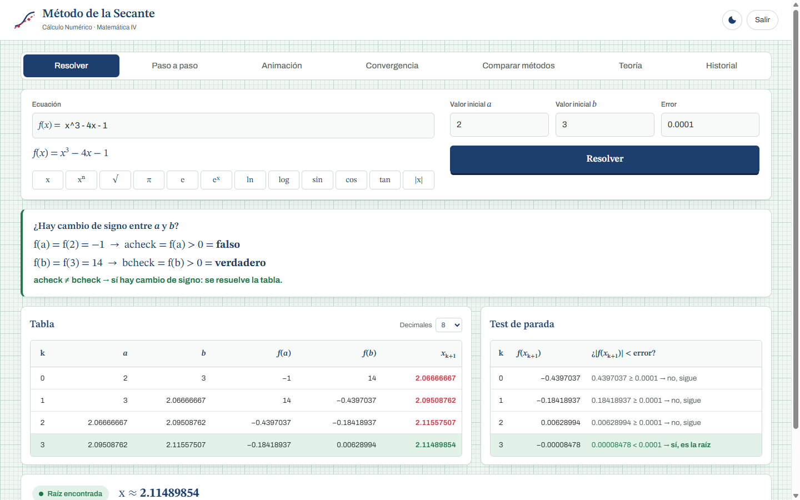
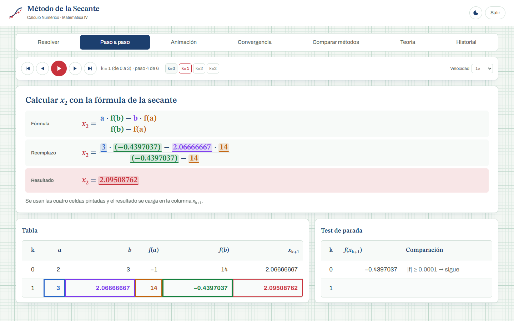

# Guía del código — cómo funciona el sistema

> **Para:** los integrantes del grupo.
> **Objetivo:** que cada uno pueda explicar el código en la defensa.
> **Lo que hay que saber:** solo dos archivos de Python, `inicio.py` y `metodos.py`. Están escritos paso a paso, como un algoritmo de PSeInt.
> La carpeta `web/` es la página (HTML, CSS y JavaScript): muestra los resultados y hace las animaciones. No hace falta explicarla.

---

## Índice

1. [El mapa: qué archivo hace qué](#1-el-mapa-qué-archivo-hace-qué)
2. [El método de la secante, a mano](#2-el-método-de-la-secante-a-mano)
3. [inicio.py — el archivo que arranca todo](#3-iniciopy--el-archivo-que-arranca-todo)
4. [metodos.py — todos los métodos](#4-metodospy--todos-los-métodos)
5. [Qué pasa cuando se toca "Resolver"](#5-qué-pasa-cuando-se-toca-resolver)
6. [Las pruebas](#6-las-pruebas)
7. [Preguntas probables en la defensa](#7-preguntas-probables-en-la-defensa)

---

## 1. El mapa: qué archivo hace qué

```
inicio.py      ← SE EJECUTA AL INICIO. Prende el servidor y abre la página.
metodos.py     ← TODOS LOS MÉTODOS: validar, cambio de signo, fórmula, tabla.
web/           ← La página: muestra la tabla, el paso a paso y las animaciones.
tests/         ← Pruebas automáticas de metodos.py.
```

**Regla de oro:** el método de la secante se resuelve en **Python**, en `metodos.py`. La página solo **muestra** lo que Python calculó y agrega gráficos y animaciones.

---

## 2. El método de la secante, a mano

**Notación que usamos:**

| Símbolo | Significado |
|---|---|
| **k** | número de iteración, **empieza en 0** |
| **a** | x<sub>k−1</sub>, el valor anterior |
| **b** | x<sub>k</sub>, el valor actual |
| **x<sub>k+1</sub>** | el valor nuevo que da la fórmula |

**Fórmula:**

```
              a · f(b) − b · f(a)
   x(k+1) = ---------------------
                 f(b) − f(a)
```

**Test de parada:** se reemplaza x<sub>k+1</sub> en la función. Si **|f(x<sub>k+1</sub>)| < error**, x<sub>k+1</sub> es la respuesta. Si no, **a toma el valor de b**, **b toma el valor de x<sub>k+1</sub>** y se pasa a la siguiente iteración.

### Ejemplo: f(x) = x³ − 4x − 1, a = 2, b = 3, error = 0.0001

**Antes de empezar: ¿hay cambio de signo?**
- f(a) = f(2) = 8 − 8 − 1 = **−1** → acheck = ¿f(a) > 0? = **falso**
- f(b) = f(3) = 27 − 12 − 1 = **14** → bcheck = ¿f(b) > 0? = **verdadero**
- acheck ≠ bcheck → **sí hay cambio de signo**, se resuelve.

**k = 0:** a = 2, b = 3
- f(a) = −1, f(b) = 14
- x₁ = (2·14 − 3·(−1)) / (14 − (−1)) = (28 + 3) / 15 = 31/15 = **2.0667**
- Test: f(2.0667) = −0.4397 → |−0.4397| = 0.4397 ≥ 0.0001 → **sigue**

**k = 1:** a = 3 (era b), b = 2.0667 (era x₁)
- f(a) = 14, f(b) = −0.4397
- x₂ = (3·(−0.4397) − 2.0667·14) / (−0.4397 − 14) = **2.0951**
- Test: f(2.0951) = −0.1842 → **sigue**

**k = 2:** x₃ = **2.1156**, f(x₃) = 0.0063 → sigue
**k = 3:** x₄ = **2.11489854**, f(x₄) = −0.00008478 → |−0.00008478| < 0.0001 → **es la raíz**

| k | a | b | f(a) | f(b) | x<sub>k+1</sub> | f(x<sub>k+1</sub>) | ¿< error? |
|---|---|---|---|---|---|---|---|
| 0 | 2 | 3 | −1 | 14 | 2.06666667 | −0.4397037 | no |
| 1 | 3 | 2.06666667 | 14 | −0.4397037 | 2.09508762 | −0.18418937 | no |
| 2 | 2.06666667 | 2.09508762 | −0.4397037 | −0.18418937 | 2.11557507 | 0.00628994 | no |
| 3 | 2.09508762 | 2.11557507 | −0.18418937 | 0.00628994 | 2.11489854 | −0.00008478 | **sí** |

**Raíz ≈ 2.11489854**



---

## 3. inicio.py — el archivo que arranca todo

Se ejecuta con `python inicio.py`. Hace tres cosas:

1. **Prende un servidor web** en la propia computadora, en `http://127.0.0.1:8765`. Es como una página de internet, pero que funciona solo en tu máquina.
2. **Abre el navegador** con la página (los archivos de la carpeta `web/`).
3. **Espera pedidos de la página.** Cuando el usuario toca *Resolver*, la página le manda los datos y `inicio.py` llama al método:

```python
if self.path == "/api/resolver":
    # Se llama al método principal con lo que escribió el usuario
    respuesta = metodos.resolver_secante(
        datos.get("funcion", ""),
        datos.get("a", ""),
        datos.get("b", ""),
        datos.get("error", ""),
    )
```

La respuesta (la tabla, la raíz, etc.) se devuelve a la página, que la muestra.

> 💡 Los datos viajan en formato **JSON**, que es texto con forma de diccionario: `{"funcion": "x^3 - 4x - 1", "a": "2", "b": "3", "error": "0.0001"}`.

---

## 4. metodos.py — todos los métodos

### 4.1 `preparar_funcion(texto)`

El usuario escribe `x^3 - 4x - 1`, pero Python necesita `x**3 - 4*x - 1`. Este método:
- saca los espacios;
- cambia `^` por `**` (así se escribe la potencia en Python);
- agrega el `*` que no se escribe: `4x` → `4*x`, `2(x+1)` → `2*(x+1)`.

Para lo último recorre el texto letra por letra con un `while`: si un número está pegado a una letra o a un paréntesis, agrega un `*` en el medio.

### 4.2 `evaluar(funcion, x)` — calcular f(x)

```python
nombres = dict(NOMBRES_PERMITIDOS)
nombres["x"] = x
resultado = eval(funcion, {"__builtins__": {}}, nombres)
```

**Reemplaza x por el número y Python hace la cuenta.** Por ejemplo, con `funcion = "x**3 - 4*x - 1"` y `x = 2`, calcula 2³ − 4·2 − 1 = −1.

- `eval` es la instrucción de Python que calcula una cuenta escrita como texto.
- `NOMBRES_PERMITIDOS` es la lista de lo que se puede usar: `x`, `sin`, `cos`, `tan`, `sqrt`, `ln`, `log`, `exp`, `pi`, `e`… Cualquier otra cosa no se acepta.
- `{"__builtins__": {}}` le quita a `eval` todo lo demás, por seguridad: solo puede hacer cuentas.

> ✔ La consigna permite usar funciones de Python **como apoyo**: `eval` solo calcula f(x). **El método de la secante lo programamos nosotros** (la fórmula, las iteraciones, el cambio de signo y el test de parada).

### 4.3 `funcion_esta_bien_escrita(funcion)`

Revisa que la función tenga sentido antes de usarla:
1. `compile` intenta leer la cuenta. Si hay un error (un paréntesis sin cerrar, un `*` de más), da `False`.
2. Revisa que solo use nombres permitidos. Por ejemplo, `x + y` da `False` porque `y` no está permitida.
3. Revisa que dependa de x.

### 4.4 `leer_numero(texto)` y `validar_datos(...)`

- `leer_numero` convierte el texto en número (acepta coma decimal: `0,001`). Si no puede, devuelve `None`.
- `validar_datos` controla los datos y arma la **lista de errores**:
  - falta la función, o está mal escrita;
  - a o b no son números;
  - a y b son iguales;
  - el error no es un número mayor que 0.

### 4.5 `hay_cambio_de_signo(fa, fb)` — acheck y bcheck

```python
def hay_cambio_de_signo(fa, fb):
    acheck = fa > 0          # ¿f(a) es positivo?
    bcheck = fb > 0          # ¿f(b) es positivo?

    if acheck == bcheck:     # los dos positivos o los dos negativos
        return False         # -> NO hay cambio de signo
    else:
        return True          # -> SÍ hay cambio de signo
```

Si f(a) y f(b) tienen el mismo signo, no hay garantía de que haya una raíz entre a y b, y **no se resuelve la tabla**.

### 4.6 `calcular_x_siguiente(a, b, fa, fb)` — la fórmula

```python
def calcular_x_siguiente(a, b, fa, fb):
    return (a * fb - b * fa) / (fb - fa)
```

Es la fórmula de la secante, escrita tal cual: (a·f(b) − b·f(a)) / (f(b) − f(a)).

### 4.7 `resolver_secante(...)` — el método principal

Es el que llama `inicio.py`. Sigue estos pasos:

```
Paso 1: validar los datos          → si hay errores, se devuelven
Paso 2: calcular f(a) y f(b)       → si no se puede (ej. ln de un negativo), error
Paso 3: si f(a) = 0 o f(b) = 0     → ya es la raíz, no hace falta iterar
Paso 4: ¿hay cambio de signo?      → si no, se avisa y NO se resuelve
Paso 5: iterar                     → arma la tabla
Paso 6: devolver el resultado
```

**El paso 5, el corazón del método:**

```python
k = 0
encontrada = False
while not encontrada and k < LIMITE_DE_ITERACIONES:

    fa = evaluar(funcion, a)
    fb = evaluar(funcion, b)

    if fb - fa == 0:                       # no se puede dividir por cero
        ...

    x = calcular_x_siguiente(a, b, fa, fb)

    # Test de parada: reemplazar x(k+1) en la función
    fx = evaluar(funcion, x)
    if abs(fx) < error:
        encontrada = True

    respuesta["tabla"].append({...})       # se guarda la fila de la tabla

    # Siguiente iteración: a toma el valor de b, y b toma el valor de x(k+1)
    a = b
    b = x
    k = k + 1
```

Línea por línea:
- `k = 0`: las iteraciones empiezan en 0.
- `while not encontrada`: se repite mientras no se encuentre la raíz.
- `fa = evaluar(funcion, a)`: se calcula f(a) reemplazando x por a. Lo mismo con f(b).
- `x = calcular_x_siguiente(...)`: se aplica la fórmula.
- `fx = evaluar(funcion, x)`: **el test de parada**, se reemplaza x<sub>k+1</sub> en la función.
- `if abs(fx) < error`: si el valor absoluto es menor que el error pedido, x<sub>k+1</sub> es la raíz. Usamos el **valor absoluto** porque f(x) puede ser negativo: −5 es menor que 0.0001, pero no está cerca de 0.
- `a = b` y `b = x`: se "corren" los valores para la siguiente iteración.

### 4.8 `LIMITE_DE_ITERACIONES = 100`

El usuario **no** elige un máximo de iteraciones: se itera hasta llegar al error pedido. Este límite solo existe para que, si el método **no converge** (por ejemplo, si la función no tiene raíz), el programa no quede trabado para siempre. Cuando la secante converge, lo hace en pocas iteraciones (4 en el ejemplo).

### 4.9 La advertencia de asíntota

Con f(x) = 1/x entre a = −1 y b = 2 hay cambio de signo, pero no por una raíz: es porque 1/x "salta" en x = 0 (una asíntota). El método termina en x = 15127, donde 1/x es muy chico pero no es cero. Por eso, si la raíz encontrada queda **fuera de [a, b]**, `resolver_secante` agrega una advertencia.

---

## 5. Qué pasa cuando se toca "Resolver"

```
  PÁGINA (web/js/app.js)                   PYTHON
  ──────────────────────                   ──────
  1. Junta lo que escribió el usuario
     {funcion, a, b, error}
  2. Lo manda a /api/resolver  ─────────►  inicio.py recibe el pedido
                                           y llama a metodos.resolver_secante()
                                              ├─ validar_datos()
                                              ├─ evaluar()  → f(a), f(b)
                                              ├─ hay_cambio_de_signo()
                                              └─ while: calcular_x_siguiente(),
                                                        evaluar(), test de parada
  4. Recibe la respuesta       ◄─────────  3. Devuelve la tabla y la raíz
  5. Muestra: cambio de signo, tabla,
     test de parada, paso a paso,
     animación, gráficos…
```



---

## 6. Las pruebas

```
python -m unittest discover -s tests -t .
```

`tests/test_metodos.py` tiene 10 pruebas que revisan:
- que `preparar_funcion` convierta bien `x^3 - 4x - 1`;
- que f(2) = −1 y f(3) = 14;
- el cambio de signo (acheck y bcheck);
- la fórmula calculada a mano: (2·14 − 3·(−1)) / (14 + 1) = 31/15;
- el ejemplo completo (raíz ≈ 2.1149, k empieza en 0, |f(x)| < error);
- que en cada iteración a toma el valor de b y b el de x<sub>k+1</sub>;
- que sin cambio de signo no se resuelve;
- las validaciones (función mal escrita, a = b, error negativo, fuera del dominio).

---

## 7. Preguntas probables en la defensa

**¿Cuál es la fórmula de la secante?**
x<sub>k+1</sub> = (a·f(b) − b·f(a)) / (f(b) − f(a)), donde a = x<sub>k−1</sub> y b = x<sub>k</sub>. Es lo mismo que x<sub>k+1</sub> = b − f(b)·(b − a) / (f(b) − f(a)): sale de buscar dónde la recta que pasa por (a, f(a)) y (b, f(b)) corta al eje x.

**¿Cómo verifican el cambio de signo?**
acheck = f(a) > 0 y bcheck = f(b) > 0. Si son iguales, f(a) y f(b) tienen el mismo signo y no hay cambio de signo. Está en `hay_cambio_de_signo()`.

**¿Por qué piden cambio de signo?**
Por el teorema de Bolzano: si f es continua y f(a) y f(b) tienen signos opuestos, hay al menos una raíz entre a y b. (En teoría la secante no lo necesita, pero así nos aseguramos de que la raíz está entre los valores iniciales.)

**¿Cuál es el test de parada?**
Se reemplaza x<sub>k+1</sub> en la función: si |f(x<sub>k+1</sub>)| < error, x<sub>k+1</sub> es la raíz.

**¿Por qué el valor absoluto?**
Porque f(x) puede dar negativo. Por ejemplo, −5 es menor que 0.0001, pero no está cerca de cero. Con el valor absoluto, |−5| = 5, que no es menor.

**¿Qué pasa en la siguiente iteración?**
a toma el valor de b, b toma el valor de x<sub>k+1</sub>, y k aumenta en 1.

**¿Cuál es la regla para saber qué valor se mantiene?**
En la secante no se elige: se descarta siempre el valor más viejo. a ← b y b ← x<sub>k+1</sub>. No se miran los signos.

**¿Y en qué se diferencia de la falsa posición?**
Usan la misma fórmula. La diferencia es la regla: la falsa posición mira el signo de f(x<sub>k+1</sub>) y conserva el extremo que mantiene el cambio de signo (si f(a) y f(x<sub>k+1</sub>) tienen signos distintos, b ← x<sub>k+1</sub>; si no, a ← x<sub>k+1</sub>). Por eso la falsa posición siempre encierra la raíz, y la secante es más rápida pero puede salirse del intervalo.

**¿Hay un máximo de iteraciones?**
El usuario no lo elige: se itera hasta llegar al error. Internamente hay un límite de 100 para que el programa no quede trabado si el método no converge.

**¿Cómo calculan f(x)?**
Con `evaluar()`: se reemplaza x por el número y Python hace la cuenta con `eval`. Antes, `preparar_funcion()` convierte lo que escribe el usuario (`x^3 - 4x`) a lo que entiende Python (`x**3 - 4*x`).

**¿Usaron alguna biblioteca para resolver el método?**
No. Python solo calcula f(x) (como una calculadora). La fórmula, el `while` de las iteraciones, el cambio de signo y el test de parada los programamos nosotros en `metodos.py`.

**¿Qué hace inicio.py?**
Prende un servidor web en la computadora, abre la página y, cuando se toca Resolver, llama a `metodos.resolver_secante()` y le devuelve el resultado a la página.

**¿Qué pasa si f(a) = f(b)?**
La fórmula dividiría por cero. El método lo detecta (`if fb - fa == 0`) y avisa.

**Hagan una iteración a mano.**
f(x) = x³ − 4x − 1, a = 2, b = 3: f(2) = −1, f(3) = 14 → x₁ = (2·14 − 3·(−1)) / (14 + 1) = 31/15 = 2.0667. *Practíquenla.*
